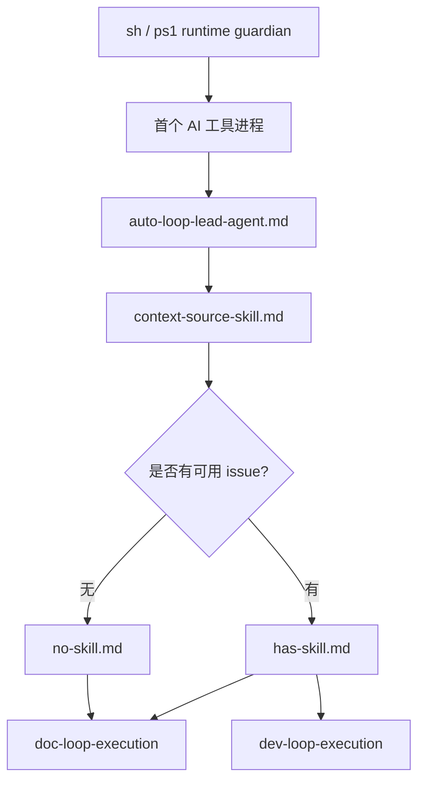
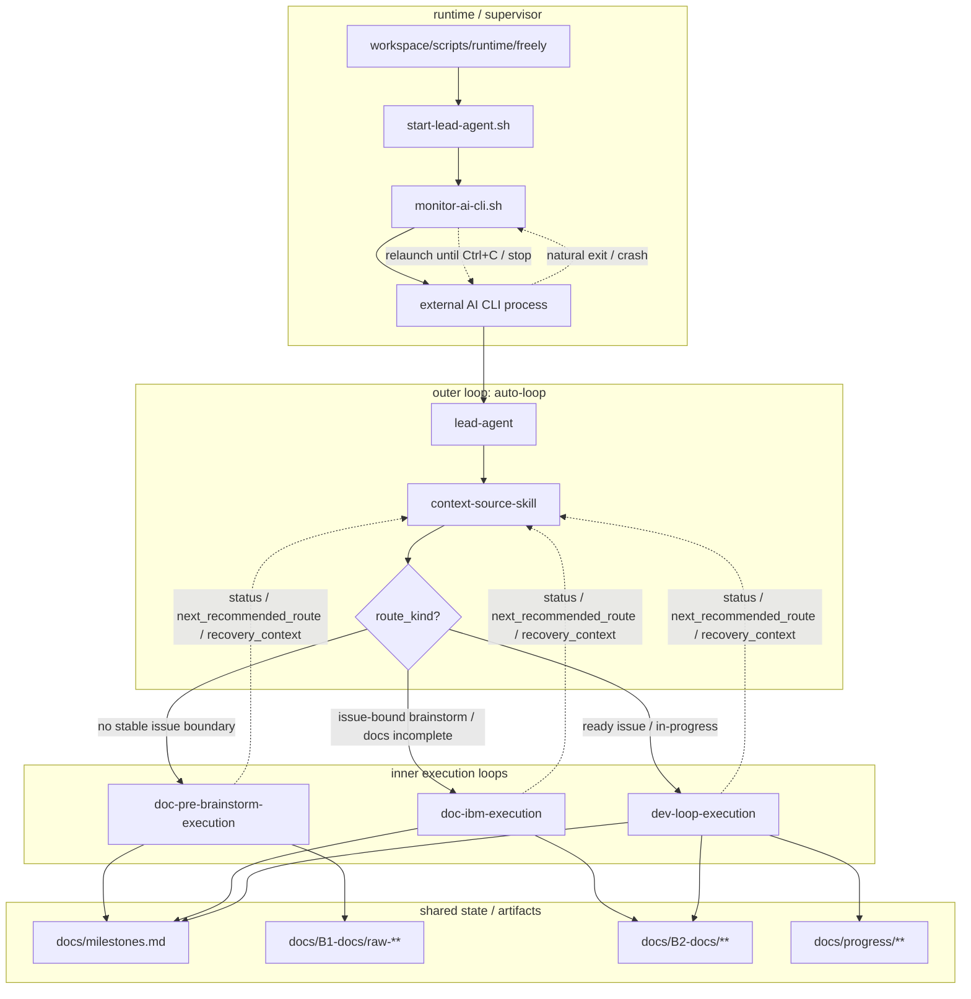

# 研究：Freely 启动到 issue/workflow skill 的首段闭环路由编排

## Context

- 日期：2026-03-06 02:48 UTC
- 触发：当前讨论已经不再只是“brainstorm 文档放哪”，而是需要把 Freely 从启动入口到正式 issue/workflow skill 的首段闭环统一起来。
- 当前已命中的关键层次：
  - `sh` / `ps1` 启动入口
  - 外部 AI CLI 工具
  - `lead-agent`
  - `context-source-skill`
  - route 判定
  - `doc-pre-brainstorm-execution`
  - `doc-ibm-execution`
  - `dev-loop(DDD)` 正式工作流接驳
- 附加约束：Freely 正在自举开发 Freely，必须在自己的 worktree / brainstorm / issue 治理下收敛这条主链，且下层设计不得与上层边界冲突。

## 当前收敛后的主问题

需要回答的已不是单点规则，而是这条首段闭环：

`sh/ps1 -> external AI CLI tool -> lead-agent -> context-source-skill -> doc-pre-brainstorm-execution | doc-ibm-execution -> dev-loop(DDD)`

因此当前预研的真实主题应收敛为：

1. Freely 启动后外部 AI CLI 工具到底如何进入首跳治理角色
2. 它如何根据上下文和来源信息做 usable issue 判定
3. 它何时进入前置研究分支，何时进入已有 issue 的正式工作分支
4. 文档落位、元数据、milestone、hook、`governance-check` 应如何作为这条主链的配套治理层，而不是主主题本身

## 已形成的统一理解

### 1. 主题层级必须是一体化的

- 前面的 brainstorm 不是历史遗迹，而是当前收敛容器
- 如果后续讨论改变了问题真实中心，就必须回写前面的主题、Context、问题定义
- 下层候选只能细化上层，不能与上层冲突
- 如果内层设计看起来在“推翻”上层，通常意味着上层标题和边界应该被重写

因此本条预研不应再继续维持“issue 绑定头脑风暴路由与兜底门禁”这个过窄主题，而应提升为“启动到 issue/workflow skill 的首段闭环路由编排”。

### 2. 现在讨论的是首段闭环，不只是 brainstorm 路径

当前真正的设计对象包括：

1. 启动层
   - `sh` / `ps1` 如何启动外部 AI CLI 工具
2. 首跳代理层
   - `lead-agent` 定义启动后首个 AI 会话承担什么职责、边界在哪里
3. 来源适配层
   - `context-source-skill` 如何读取 chat / story-scoped code-reviews / test / milestone / issue / recovery 等上下文来源
4. 路由判定层
   - 如何做 usable issue 判定
5. 第二跳分支层
   - 无 usable issue -> `no-usable-issue-skill`
   - 有 usable issue -> `has-usable-issue-skill`
6. 正式工作流接驳层
   - 继续进入 `doc-loop(IBM+G)` 或 `dev-loop(DDD)`
7. 配套治理层
   - brainstorm 落位
   - 最小元数据契约
   - milestone 绑定
   - hook / `governance-check` 兜底

### 3. `agent` 与 `skill` 必须分层

- `agent` 负责角色定义
- `skill` 负责局部工作法与可执行编排
- Freely 当前编排的是外部 AI CLI 工具，而不是自研 AI CLI runtime
- 因此“启动后谁负责总控”应由 `lead-agent` 承担
- 而“根据来源怎么编排下一跳”应收敛到被 `lead-agent` 调用的 `context-source-skill`

当前不单独引入第三类 `orchestrator/guidance` 产物：

- 跨层装配、路由接驳、调用关系仍通过 skill 表达
- `agent` 只负责角色，不承担技能目录的混合职责

### 4. 命名不再使用 loop 前缀

- 名称只表达职责，不表达 loop 归属
- 主归属通过目录表达
- 可调用范围通过元数据表达
- 因此新产物不使用 `auto-loop-*`、`doc-loop-*`、`dev-loop-*` 这类前缀命名规则
- 现有历史名称若已稳定存在，可暂时保留；新增产物遵循新规则

路径归属总原则：

- `docs/system/workspace/` 是 Freely 对外暴露工作能力的统一入口
- `agents`、`skills`、`scripts`、`hooks` 都应在 `system/workspace` 下有清晰归属或映射
- `bin/`、`.githooks/` 等运行时位置不应作为主定义源，而应视为安装或投影后的落点

当前建议的正式落点路径应为：

- `agent`: `docs/system/workspace/agents/lead-agent.md`
- `skill`: `docs/system/workspace/skills/context-source-skill/SKILL.md`
- `skill`: `docs/system/workspace/skills/no-usable-issue-skill/SKILL.md`
- `skill`: `docs/system/workspace/skills/has-usable-issue-skill/SKILL.md`
- 现有对齐项：`docs/system/workspace/skills/auto-loop-orchestrator/SKILL.md`
- `script`: `docs/system/workspace/scripts/` 下定义 `sh` / `ps1` 启动与编排脚本
- `hook`: `docs/system/workspace/hooks/` 下定义 hook 规范或模板；根目录 `.githooks/` 作为运行时安装产物

### 5. 文档落位规则已降级为配套子问题

之前的 brainstorm-routing 结论并没有失效，但它现在属于更大主题下的治理子问题：

- 没有明确 issue 证据时，brainstorm 文档默认落到 `docs/B1-docs/raw-`
- 只有存在明确 issue 证据时，brainstorm 文档才允许落到 `docs/B2-docs/.../brainstorms/`
- 这条规则只解决“brainstorm 文档落位”
- 它不能单独决定总任务路由

### 6. 启动后总控归 `lead-agent`，来源编排归 `context-source-skill`

- `sh` / `ps1` 只负责启动外部 AI CLI 工具
- `sh` / `ps1` 应归入 `system/workspace/scripts` 能力面统一理解
- AI CLI 工具启动后，由 `lead-agent` 接管首段闭环
- `lead-agent` 负责调用 skill，而不是内嵌所有来源判定细节
- 与上下文来源相关的编排与路由决策，统一收敛到 `context-source-skill`
- `context-source-skill` 产出下一跳决策：进入 `no-usable-issue-skill` 或 `has-usable-issue-skill`

### 7. usable issue 判定才是主路由分叉点

不能把路由简化成：

- `有 issue -> IBM`
- `没 issue -> pre-brainstorms`

更准确的理解是：

- `没命中 usable issue` -> `no-usable-issue-skill` -> 继续 `pre-brainstorms`
- `命中 usable issue` -> `has-usable-issue-skill` -> 继续正式 issue 工作流
- `has-usable-issue-skill` 本身不替代 `doc-loop(IBM+G)` / `dev-loop(DDD)`，而是负责把已有 issue 接到 issue-bound `doc-loop(IBM+G)`

### 8. milestone 是首跳扫描层之一

当前更合理的扫描顺序应接近：

1. milestone
2. progress / recovery
3. issue 文档
4. pre-brainstorms candidates
5. review / test / chat / 新输入

原因：

- milestone 不应只是后置报表
- milestone 应表达当前项目阶段、当前批次关注范围、issue 是否 ready、是否仍需研究、优先级和相对顺序
- `pre-brainstorms` 的 candidate 不能长期悬空，所有非 dropped candidate 都应进入 milestone 体系

## 需要回答的问题

### A. 启动到首跳代理

1. `sh` / `ps1` 对外部 AI CLI 工具的启动契约是什么？
2. 外部 AI CLI 工具与 `lead-agent` 的关系应如何表述，才能避免把它误写成业务执行器？

### B. 首跳代理到来源适配

1. `lead-agent` 是否只负责首跳总控，不直接承担 doc/dev-loop 的领域工作？
2. `context-source-skill` 的最小职责集合是什么？
3. 它应读取哪些上下文来源，按什么优先级整合？

### C. 来源适配到 usable issue 判定

1. 什么才算 usable issue，而不是“仅存在某个 issue 文件”？
2. 连续开发 / recovery 如何可靠绑定原 issue？
3. milestone、progress、issue status、runtime 状态各自如何参与判定？

### D. usable issue 分流到第二跳

1. 无 usable issue 时，`no-usable-issue-skill` 的标准产物和停止条件是什么？
2. 有 usable issue 时，`has-usable-issue-skill` 如何把 issue 正确接入 issue-bound `doc-loop(IBM+G)`？
3. issue-bound brainstorm 与新的 pre-brainstorm 之间的边界如何定义？

### E. 配套治理层

1. brainstorm 文档落位规则如何作为主链配套门禁表达？
2. 让 hook / script 低成本判断所需的最小元数据集合是什么？
3. `pre-commit`、`governance-check`、创建入口各自应该承担什么边界？
4. `system/workspace/hooks` 与运行时 `.githooks/` 之间应如何定义“定义源 vs 安装产物”的关系？

## 当前观察

### 1. 已有规则来源

- `AGENTS.md`
  - 非 issue 前置研究 -> `docs/B1-docs/raw-`
  - 基于已有 issue 的 IBM brainstorm -> `docs/B2-docs/{epic}/{story}/brainstorms/b-{issue-name}.md`
- `PROJECT_INTENT.md`
  - chat / review / 新问题先进入 `pre-brainstorms`
  - ready issue / in-progress issue 再进入正式工作流
- 宪法 / 法律
  - `doc-loop(IBM+G)` 与 `dev-loop(DDD)` 的正式分层已经存在
  - worktree / agent 上下文与 skills 已是现有治理结构的一部分

### 2. 执行缺口

- 还没有一个显式的“启动入口 -> 首跳代理 -> 来源适配 -> usable issue 分流”的统一说明
- `.githooks/` 目前没有检查 brainstorm 路由是否正确
- `bin/governance-check` 与 `bin/freely` 若仍引用旧 `docs/brainstorms/` 路径，说明旧工作流残留尚未清理
- 当前没有统一的 brainstorm 元数据契约，导致脚本难以判断 issue 绑定关系
- `sh` / `ps1` / hooks 的定义源与运行时落点尚未统一到 `system/workspace` 口径

### 3. 风险

- 如果没有显式首段闭环模型，`lead-agent`、`context-source-skill`、`no/has-usable-issue-skill` 会继续混层
- 如果只靠路径名或文件名猜测 brainstorm 类型，会出现误判
- 如果在 pre-commit 做过重自动迁移，会把错误变成隐蔽状态
- 如果 candidate 已经收敛到新主题，但前面的 brainstorm 仍维持旧题目，整条文档链会继续失真
- 如果把编排层再拆成第三类独立产物，会与当前“agent + skill”两类模型冲突
- 如果 `scripts` / `hooks` 继续散落在根目录语义中，`system/workspace` 就无法成为完整能力入口

## 新增纠偏：自举开发视角下的职责边界

### 1. 当前问题仍属于本条预研，不新开题

- 当前讨论的仍然是“Freely 从启动外部 AI CLI 工具到正式 issue/workflow skill 的首段闭环”
- 新增讨论虽然更强调“谁在做工作”，但没有超出本条主问题
- 因此本轮应继续更新当前 `brainstorms.md` / `candidates.md`，而不是新建平行 pre-brainstorm

### 2. Freely 是运行器，不是脚本写死任务的执行器

- Freely 面向用户时，是一个托管外部 AI 工具持续运行的应用
- Freely 当前自举开发自己时，也必须使用同样的治理模型
- 因此运行时脚本负责“让 AI 工具开始工作并保持可续接”，而不是负责业务型需求判断
- 真正的需求发现、边界判断、优先级选择与工作流路由，必须由 AI 在 skill 指南下完成

### 3. `sh` / `ps1` 的职责：运行保障，不做业务判断

- `sh` / `ps1` 负责首次启动外部 AI CLI 工具
- 负责 AI 工具崩溃、阻塞、定时唤醒、resume、PID 监控、停止
- 负责把最小固定上下文交给首跳 AI 会话
- 它启动的不是“Freely 软件本体去做工作”，而是“某个 AI 工具开始在 Freely 运行器下自治工作”
- 它不负责：
  - 扫描需求池
  - 判断当前优先来源
  - 判断进入 pre-brainstorm、IBM 还是 DDD
  - 判断测试 / review 发现的问题是否还在原 issue 边界内

### 4. `lead-agent` 的职责：首跳接管与委托，不负责找活

- `lead-agent` 是首跳 AI 会话的总控角色
- 它负责：
  - 接管刚启动的 AI 工具
  - 先执行治理前置门禁
  - 明确当前进入 Freely 的自治工作模式
  - 将需求池扫描、上下文解释、优先级判断委托给 `context-source-skill`
- 它不负责：
  - 自己去扫描所有来源池
  - 自己展开全部来源判定细节
  - 自己代替 IBM / DDD 做领域工作

### 5. `context-source-skill` 的职责：需求池扫描与路由编排核心

- 真正“找活”的核心不在 `lead-agent`，而在 `context-source-skill`
- 它应指导 AI 扫描这些需求池：
  - `milestones`
  - `progress`
  - `recovery`
  - `review`
  - `test`
  - `chat`
  - `github issue`
  - `PROJECT_INTENT`
- 它的职责不是读取单一来源，而是让 AI 基于当前上下文判断：
  - 现在先看哪个池
  - 哪个池优先级更高
  - 当前问题是否已有稳定 issue 边界
  - 应进入 `pre-brainstorm`、`issue-bound brainstorm` 还是 `issue continuation`
- 这些判断不应由脚本硬编码

### 6. `test` / `review` / `chat` 都必须先重做边界判断

测试发现问题，不代表一定直接进入开发；review 或 chat 也同理。

更稳的判断应是：

1. 若问题仍在原 issue 边界内
- 属于 `issue continuation`
- 交由 `has-usable-issue-skill` 继续接入 issue-bound `doc-loop(IBM+G)`

2. 若问题与原 issue 强相关，但已超出当前边界
- 属于 `issue-bound brainstorm`
- 进入 IBM 的 `B`
- 不是回 pre-brainstorm

3. 若问题没有稳定 issue 边界
- 属于 `pre-brainstorm`
- 进入 `no-usable-issue-skill`

因此“来源类型”不能直接决定路径，必须先做边界判定。

### 7. `no-usable-issue-skill` 与 `has-usable-issue-skill` 的真正分工

- `no-usable-issue-skill`
  - 负责 pre-brainstorm 收敛
  - 负责 `brainstorms.md` / `candidates.md`
  - 负责 candidate -> milestone 同步
  - milestone 绑定后负责 candidate 回写
- `has-usable-issue-skill`
  - 负责已有稳定 issue 边界下的正式工作流入口
  - 负责将问题送入 issue-bound IBM 或 DDD
  - 不再回到 pre-brainstorm candidate 线

### 8. 之前的候选不是推翻重来，而是继续纠偏收敛

- 当前已落地的 4 个核心产物方向是对的
- 问题不在“要不要这些产物”，而在“职责是否写准”
- 因此本轮不新建一批平行 candidate，而是修正现有 candidate 的 acceptance hint 和决策理由

### 9. 两个第二跳 skill 的产物边界必须写实

`no-usable-issue-skill` 的结束产物应保持在 pre-brainstorm 侧：

- `docs/B1-docs/raw-<id>/brainstorms.md`
- `docs/B1-docs/raw-<id>/candidates.md`
- `docs/milestones.md` 中的 candidate entry

它负责把“原始问题”收敛成 candidate，并把 candidate 同步进 milestone；它不直接产出正式 story 目录下的 issue / brainstorm / prd / pre-tests / tasks。

`has-usable-issue-skill` 的职责不是一句“有 issue 就继续”就结束，而是要把 issue-bound `doc-loop(IBM+G)` 接入做完整：

- 若进入 `IBM`，应要求 issue 目录下至少维护：
  - `docs/B2-docs/{epic}/{story}/issues/{issue-name}.md`
  - `docs/B2-docs/{epic}/{story}/brainstorms/b-{issue-name}.md`
  - `docs/B2-docs/{epic}/{story}/prd.md`
  - `docs/B2-docs/{epic}/{story}/pre-tests.md`
  - `docs/B2-docs/{epic}/{story}/tasks.md`
- `no-usable-issue-skill` 负责 `pre-brainstorm -> candidate -> milestone`
- `has-usable-issue-skill` 负责 `usable issue -> doc-loop(IBM+G)`
- `dev-loop-execution` 负责 `DDD`
- `PRE_TEST` 属于 issue-bound `IBM` / doc-loop 产物，不属于 pre-brainstorm 产物

## 暂时结论

当前更稳的路线应是：

1. 先把首段闭环主链写清：
   `sh/ps1 -> external AI CLI tool -> lead-agent -> context-source-skill -> usable-issue decision -> no-usable-issue-skill | has-usable-issue-skill -> doc-loop(IBM+G) -> dev-loop(DDD)`
2. 再分别定义每一层的职责边界和输入输出
3. 产物类型只分为 `agent` 与 `skill`，不额外引入第三类 `orchestrator/guidance`
4. `system/workspace` 统一作为能力真源，纳入 `agents`、`skills`、`scripts`、`hooks`
5. 将 brainstorm 路由、元数据契约、milestone 绑定、hook / `governance-check` 明确降为治理配套层
6. 让 `candidates.md` 只承载这条主链下的文档型产物，不再回到旧题目
7. 后续再将这些候选物化为正式 issue，并绑定 milestone
8. runtime 脚本只负责启动、监控、续接与停止；需求池扫描和路由判断由 AI 在 `context-source-skill` 下完成
9. `lead-agent` 负责首跳接管与委托；“找活”职责归 `context-source-skill`
10. `test` / `review` / `chat` 等来源命中后，必须先做 issue 边界判定，而不是按来源名直接硬编码路径

## 本轮候选落地方向

### 方向 1：先固化首段闭环的 4 个核心文档

- `lead-agent.md`
- `context-source-skill.md`
- `no-usable-issue-skill.md`
- `has-usable-issue-skill.md`

优点：

- 先把首段主链固定
- 避免后续继续在脑中模型和文档模型之间漂移

### 方向 2：同时补一个现有 orchestrator skill 对齐项

- 把启动器、lead-agent、source-skill、no/has-usable-issue skill、doc/dev-loop 的主链统一回现有 orchestrator skill

优点：

- 防止“新模型只存在于预研文档里”

### 方向 3：后补治理层兜底

- brainstorm 文档落位
- 最小元数据契约
- milestone 原子绑定
- `system/workspace/hooks` -> `.githooks/` 的安装映射
- `pre-commit` / `governance-check` 兜底

优点：

- 先固定主链，再补配套门禁，避免治理层先于主模型定死错误边界

1. 已明确 milestone 归属
- 已知道属于哪个 milestone
- 已知优先级和大致顺序

2. 已进入某个 milestone 的候选池
- 说明这个 issue 不会被丢失
- 但仍需继续研究、排序或跨 issue 收敛

3. 仍是 pending milestone binding
- 只允许短暂过渡
- 不应成为长期停留状态

因此，当前 `pending://milestone-binding` 更像临时占位，而不是稳定终态。

### 3. 里程碑内部应允许“候选列表”层

你提的这个点是对的。

一个 milestone 内部不能只存“完全 ready 的 issue”，还需要容纳：
- 还要继续研究的问题
- 单个 issue 已达标，但与项目其他 issue 还未整体收敛的问题
- 已知要做，但尚未想清放在哪个阶段顺序的问题

所以 milestone 内部至少应区分两层：

1. `committed_issues`
- 已 ready
- 已具备执行条件
- 有明确顺序或阶段位置

2. `candidate_issues`
- 尚未 dropped
- 已确认属于该 milestone 关注范围
- 但可能仍需研究 / 排序 / 依赖收敛

这样可以避免两个坏结果：
- 还没 ready 的 issue 被迫伪装成 ready
- 候选 issue 因未完全收敛而在里程碑体系里消失

### 4. candidate 状态变化时，应同步写 milestone

这部分应该形成硬规则：

- 当 `candidates.md` 中某个候选项状态不是 `dropped` 时
  - 必须同步写入 milestone
- 写 milestone 时，至少要声明该 issue 当前属于：
  - committed
  - candidate
  - research-needed
  - sequencing-pending

也就是说，candidate 的状态写入不该只改 `candidates.md`，还要原子更新 milestone 映射。

### 5. milestone 开头应有元数据，解释状态语义和行动规则

这点很重要。否则同一个状态名，AI 和人会各自理解。

milestone 文档头部应该至少声明：

```md
milestone_id: <id>
milestone_status_policy_version: v1
candidate_policy:
  dropped: remove from active milestone queues
  needs_research: keep in candidate_issues; route back to pre-brainstorm or issue-brainstorm
  proposed: keep in candidate_issues; waiting for convergence
  ready: move to committed_issues when sequencing is clear
  in_progress: must exist in committed_issues and progress tracking
  blocked: keep visible with blocker and next action
sequencing_policy:
  ordered_by: dependency_then_value
  allow_unordered_candidates: true
routing_policy:
  no_issue_path: route to pre-brainstorms
  issue_path_present: enter issue-bound handling and decide between issue-bound brainstorm / IBM / continuation based on status
```

重点不是字段名字，而是 milestone 文档开头必须回答：
- issue 状态怎么标记
- 每个状态怎么理解
- AI 看到该状态后应该怎么行动

### 6. 这会反过来影响 brainstorm 路由判断

如果 milestone 成为第一扫描层，那么 brainstorm 的“是否基于 issue”判断会更稳定：

1. milestone 中已有正式 issue path
- 说明当前问题已进入“已有 issue”方向
- 后续仍需结合状态决定是 issue-bound brainstorm、IBM、continuation 还是 completion verification

2. milestone 中只有 candidate entry，没有正式 issue path
- 后续仍应先回到 pre-brainstorm / candidate 收敛

3. milestone 中标记为 research-needed
- 默认说明还没进入正式 issue 执行面
- 若已有 issue 且仍在原边界内，应继续 issue-bound brainstorm；否则回 pre-brainstorm

4. milestone 中标记为 continuation of issue
- 后续工作应绑定原 issue，而不是新开 pre-brainstorm

### 7. 当前工作方法里缺的那一跳

当前方法更像：
- pre-brainstorm -> candidates -> issue-ready

但还缺：
- candidate 写状态时，必须同步 milestone
- milestone 决定 issue 是否 ready / candidate / research-needed
- milestone 反过来决定后续 brainstorm 路由

也就是更完整的方法应该接近：
1. pre-brainstorm 产出 candidates
2. candidate 写入状态时，原子同步 milestone
3. milestone 作为主动扫描源决定下一步
4. 若已进入已有 issue 方向，则结合状态决定 issue-bound brainstorm / IBM / continuation / completion verification
5. 若仍未形成 issue 或仍处于 candidate 研究态，则继续 pre-brainstorm 收敛

## 暂时修正后的判断

### 修正 1：milestone 不是可选附属，而是核心路由层
- 不应只在 issue 成熟后才写 milestone
- candidate 进入活跃状态时就应写 milestone

### 修正 2：`pending://milestone-binding` 只能是短暂过渡态
- 长期存在说明流程没有闭环
- 后续可考虑用 hook / `governance-check` 检测长期未绑定 candidate

### 修正 3：issue 路由判断应结合 milestone
- 不是单看 brainstorm 文件本身
- 还要看 milestone 是否已经承认它为正式 issue 或仅为 candidate

### 修正 4：Freely 自举时，当前候选必须立即进入真实 milestone
- Freely 既然要求托管项目把 milestone 当作主动扫描层，就不能让自己的活跃候选长期只停留在 `candidates.md`
- 因此本轮 `C-20260306-1101` ~ `C-20260306-1105` 应立即绑定到 `docs/milestones.md#m-20260306-workspace-routing-foundation`
- `C-20260306-1101` ~ `C-20260306-1104` 进入该 milestone 的 `committed_issues`，表示顺序已清晰、下一步应继续物化 issue 或直接进入 doc-loop 产出
- `C-20260306-1105` 保留在同一 milestone，但标记为已完成对齐项，作为当前批次已经落地的证据
- 后续启动时，Freely 应优先从 milestone 读取这批项，而不是再次把它们当成无归属候选重新解释

## 新增待收敛问题

### 新增纠偏：`no/has-usable-issue-skill` 可能是错误分层

进一步对照 `PROJECT_INTENT`、`doc-loop-execution`、`dev-loop-execution` 之后，当前模型里还有一层结构性重复风险：

- `context-source-skill` 已经负责：
  - 扫描需求池
  - 判断 issue 边界
  - 产出 `route_kind`
- `has-usable-issue-skill` 若继续负责“有 issue 后怎么进 `doc-loop` / `dev-loop`”，就会和真正的 loop skill 重叠
- `no-usable-issue-skill` 若只是“没 issue 就去 pre-brainstorm”，则更像 route 分支名，而不是稳定工作能力

也就是说，当前 `no/has` 两个 skill 名字按“是否有 usable issue”切开，容易把“路由条件”误建模成“工作能力”。

### 重新拆层后，更稳的职责应接近：

1. `auto-loop`
   - 负责外循环编排
   - 负责在每一轮根据当前状态决定进入哪个环
   - 负责接收环内产物、状态、阻塞、崩溃、正常结束，再进入下一轮

2. `lead-agent`
   - 负责首跳接管与委托
   - 不负责具体找活或执行领域工作

3. `context-source-skill`
   - 负责扫描需求池、解释上下文、判断 issue 边界
   - 负责产出本轮 route decision
   - 但不直接承担 loop 内部执行

4. 真正的领域工作 skills
   - `doc-pre-brainstorm-execution`
   - `doc-ibm-execution`
   - `dev-loop-execution`

这里最关键的是：

- `pre-brainstorm` 本身也应被视为一种文档工作能力
- `IBM` 是 `doc-loop` 的 issue-bound 文档能力
- `DDD` 是 `dev-loop` 的实现能力

所以更自然的模型不是：

`context-source-skill -> no-skill | has-skill -> doc-loop | dev-loop`

而是：

`context-source-skill -> doc-pre-brainstorm-execution | doc-ibm-execution | dev-loop-execution`

### 这样拆的好处

1. skill 名字表达“做什么”，而不是“当前判定结果是什么”

- `doc-pre-brainstorm-execution`：做 pre-brainstorm 收敛
- `doc-ibm-execution`：做 `IBM+G`
- `dev-loop-execution`：做 `DDD`

2. 避免中间层重复

- `has-usable-issue-skill` 会和 `doc-ibm-execution` 重复“已有 issue 后怎么进入 doc-loop”
- `no-usable-issue-skill` 会和 `context-source-skill` 重复“没 issue 时走 pre-brainstorm”

3. 更符合外循环 / 内循环关系

- 外循环负责路由：进哪个环
- 内循环 skill 负责在环内正常工作
- 工作结果、状态交换、阻塞、崩溃、正常结束都回到外循环

### 因此当前更稳的收敛方向应改为

`sh/ps1 -> external AI CLI tool -> lead-agent -> context-source-skill -> doc-pre-brainstorm-execution | doc-ibm-execution | dev-loop-execution`

进一步解释：

- `auto-loop` / runtime 负责：
  - 启动
  - 监控
  - 续接
  - 停止
  - 外循环路由
- `context-source-skill` 负责：
  - 扫描需求池
  - 判断进入哪个环
- 一旦某个 loop skill 被调用：
  - 就视为已经进入那个环
  - 该 skill 要在环内按自己的方法论正常工作
  - 结束后把状态交换回 `auto-loop`

### 对当前已落地产物的影响

这意味着当前已经落地的：

- `no-usable-issue-skill`
- `has-usable-issue-skill`

很可能不是最终稳定命名。

更可能的后续收敛是：

- 将二者合并或替换为更薄的 route/handoff 层，甚至直接取消
- 把 pre-brainstorm 抽成独立 skill
- 保留 `doc-ibm-execution`
- 保留 `dev-loop-execution`

### 当前暂时判断

当前 `no/has-usable-issue-skill` 可以视为过渡产物，用于帮助把主链先说清。

但从长期模型看，更正确的技能层级应是：

- `context-source-skill`：判断进哪个环
- `doc-pre-brainstorm-execution`：前置收敛
- `doc-ibm-execution`：`IBM+G`
- `dev-loop-execution`：`DDD`

因此，后续若继续纠偏，优先级应是：

1. 将 `pre-brainstorm` 抽成独立 doc skill
2. 收缩或移除 `no/has-usable-issue-skill`
3. 让 `auto-loop` 直接编排 `pre-brainstorm/doc/dev` 三个执行环

### 关于是否需要新 worktree / 新 pre-brainstorm 的判断

这次纠偏虽然较大，但仍属于同一主题：

- 都在回答 Freely 启动后的自治闭环如何分层
- 都围绕 `lead-agent`、`context-source-skill`、外循环与内循环、以及 `pre-brainstorm/doc/dev` 的职责切分
- 不是新的产品方向，也不是独立治理主题

因此当前更合理的做法是：

- **继续当前 worktree**
- **继续当前 pre-brainstorm**
- 在本条预研内直接修正之前的 `no/has` 中间层设计

不新开平行 worktree 的原因：

- 当前分支尚未进入合并阶段，仍处于预研收敛
- 新分支只会制造两条相互竞争的结构设计
- 真正需要的是在当前问题内形成单一结论，而不是把纠偏再拆成平行问题

1. candidate 的状态枚举是否需要统一升级？
   - 当前常见有：`proposed | promoted | dropped | needs_research`
   - 但 milestone 层可能需要：`candidate | research-needed | sequencing-pending | committed | in_progress | blocked`
2. `promoted` 是否足够表达“已成为正式 issue”，还是应该拆成：
   - `issue_materialized`
   - `milestone_bound`
   - `sequenced`
3. milestone 文档是否要从单一 `docs/milestones.md` 进一步结构化成：
   - 全局索引
   - 单 milestone 文档
4. milestone 与 progress/recovery 的边界如何定义，避免重复记录？

## 新增讨论：会话启动应是 `context + milestone` 路由，而不是静态扫表

### 1. 路由输入不是“有没有 issue”，而是 `input_context + milestone_path`

当前更准确的定义应是：
- 路由器输入不是单独的 issue id，也不是盲扫 milestone
- 路由器输入应是：
  - `input_context`
  - `milestone_path`

也就是：

```text
router(input_context, milestone_path)
```

其中：
- `input_context` 可以来自：
  - 用户 chat input
  - review 信号
  - test 信号
  - recovery 信号
  - AI 自治发现的问题描述
- `milestone_path` 是当前项目活跃 milestone 的语义索引与状态表

### 2. auto-loop 的职责不是替代上下文，而是组装上下文

对于 Freely 自举和未来产品化后的运行方式：
- 人类会话：chat input 就是 context
- AI 自治：auto-loop 负责把发现的问题组织成 context，再传给路由器

例如概念上应接近：

```bash
iflow -p "<context>"
```

这里的 `<context>` 不是普通提示词补充，而是本次任务发现的标准化输入。

因此 auto-loop 不应“无上下文盲扫项目”，而应：
1. 收集触发信号
2. 组装 `input_context`
3. 调用统一路由器

### 3. milestone 是被 context 检索的，不是固定优先级队列

这意味着：
- milestone 不是“先看 in_progress，再看别的”的死板扫描顺序
- milestone 是“当前项目任务语义索引 + 状态路由表”
- 必须先用 `input_context` 在 milestone 中做语义命中，再根据命中结果看状态

也就是说，第一步是：
- 根据当前上下文，在 milestone 中找最相关的 issue / candidate / follow-up 项

第二步才是：
- 根据该项状态决定是否进入 pre-brainstorm、IBM、continuation 或 completion verification

### 4. 会话启动的正确顺序

会话启动时应是：
1. 获取 `input_context`
2. 用 `input_context` 检索 milestone 中的相关 issue / candidate
3. 若命中，再检查状态与边界
4. 最终决定路由

而不是：
- 先静态看 milestone 里谁是 `in_progress`
- 然后不考虑本次上下文就默认继续

### 5. “没有明确指令”不等于没有上下文

这点需要显式写清。

对于 AI 自治：
- 用户没有显式下指令
- 但 auto-loop 发现的问题、review 结果、test 失败、会话恢复信号，本身都构成 `input_context`

因此：
- `no explicit user intent` != `no context`
- 路由依然要由 context 驱动

## 新增讨论：基于命中状态的分流

### 1. 未命中任何已有 issue / candidate

若 `input_context` 在当前 milestone 中未命中任何已有 issue 或 candidate：
- 路由到 `pre-brainstorms`
- 产出新的 candidate issue
- 并同步写入 milestone candidate 区，不能悬空

### 2. 命中 candidate 或 research-needed

若命中项当前状态仍属于研究态，例如：
- `candidate`
- `research-needed`
- `sequencing-pending`

则默认进入研究流，而不是直接执行。

分流细化：
- 若命中的是 milestone candidate：通常继续 `pre-brainstorms` 研究链
- 若命中的是已有 issue 但仍在研究态：进入 issue-bound brainstorm（`IBM/B`）
- 若语义已明显超出原边界：新开 pre-brainstorm

### 3. 命中已有 issue，状态为 not-started，但已足够清晰

若命中已有正式 issue，且：
- 当前不需要重新研究
- 问题边界清晰
- 只是尚未开始文档接入/推进

则进入 `doc-loop(IBM)`，而不是回 pre-brainstorm。

但在进入 `IBM` 前，应先检查 milestone 内该 issue 的位置是否需要调整：
- 同 milestone 内顺序是否需要调整
- 是否需要跨 milestone 挪动
- 是否需要从 candidate 区移动到 committed 区

### 4. 命中已有 issue，状态为 in-progress

此时默认不是“重新 intake”，而是先检查运行时状态：

1. 相关 AI 进程是否存在
2. 若不存在，是否需要重启
3. 是否存在 recovery / progress 记录
4. 是否存在对应的会话 jsonl 地址
5. 观察 jsonl 结尾状态，判断：
   - attach
   - resume
   - restart
   - failure recovery

所以：
- `in-progress` 默认路由是 `continuation_or_recovery`
- 不是默认重新进入 pre-brainstorm 或 IBM

### 5. 命中已有 issue，状态为 done

命中 done 也不能直接视为结束。
还应检查：
- 完成状态标记是否达标
- 是否缺 closing evidence
- 必需产物是否齐全

若未达标：
- 不应保持 done
- 应回到 `IBM` 补文档或进入 recovery/closure flow

若已达标，但当前 context 语义是一个 follow-up 新问题：
- 不应强行挂回已完成 issue
- 应新开 pre-brainstorm，产出 follow-up candidate

## 新增讨论：里程碑需要承载可执行状态语义

仅有 `todo/doing/done` 之类标签是不够的。
里程碑中的每个 issue/candidate，至少应能表达：
- 当前状态
- 默认路由
- 是否仍在原边界内可继续
- 完成判定如何检查
- recovery 时应看哪些记录

因此 milestone 元数据或条目结构中，后续可能需要：
- `default_route`
- `boundary_note`
- `recovery_hint`
- `completion_check`

## 修正后的总路由逻辑

当前更准确的总逻辑应是：

```text
brainstorm_doc_placement = issue_evidence_check
route = context_match(milestone, issue, candidate)
      x item_status
      x boundary_check
      x runtime_state
```

其中：
- `brainstorm_doc_placement` 解决文件放在 `pre-brainstorms` 还是 `epics/.../brainstorms/`
- `route` 解决这次任务进入 `pre-brainstorms`、`IBM/B`、`IBM`、continuation/recovery 还是 completion verification

其中：
- `context_match`：先决定当前上下文命中了哪个任务实体
- `item_status`：决定它是研究态、未开始、进行中还是已完成
- `boundary_check`：判断当前语义是否仍在原 issue/candidate 边界内
- `runtime_state`：在 `in-progress` 时决定 attach / resume / restart / recovery

## 当前进一步收敛出的工作方法

会话启动时更完整的方法应接近：
1. 获取 `input_context`
2. 在当前 milestone 中做语义命中
3. 若未命中：进入 pre-brainstorm，产出 candidate issue
4. 若命中研究态：继续研究流
5. 若命中 not-started 且已清晰：先做 milestone alignment，再进入 `doc-loop(IBM)`
6. 若命中 in-progress：检查进程、recovery、jsonl 结尾状态，再 continuation/recovery
7. 若命中 done：先做完成达标检查；若是新 follow-up，再新开 pre-brainstorm

## 新增待收敛问题

1. `input_context` 的最小标准化结构是什么？
2. milestone 条目是否必须增加 `default_route`、`boundary_note`、`recovery_hint`、`completion_check`？
3. `in-progress` 的 jsonl 结尾状态应该有哪些枚举值，才能稳定决定 attach / resume / restart？
4. “完成状态标记达标”最小需要哪些证据？


## 新增讨论：`pre-brainstorms -> candidates -> route` 应改为 `pre-brainstorms -> candidates -> milestone -> route`

### 1. `pre-brainstorms` 不应再承担最终路由职责

如果 pre-brainstorm 已经完成研究并产出 candidate issue：
- 它的结束动作应是把 candidate 写入 milestone
- 而不是自己直接决定进入 `doc-loop` 或 `dev-loop`

也就是说：
- `pre-brainstorms` 负责前置研究收敛
- `candidates.md` 负责记录候选 issue 结果
- milestone 负责后续活跃任务路由

### 2. `candidates.md` 是研究层，不是调度层

这意味着 `candidates.md` 的角色需要收缩为：
- 研究过程的候选 issue 记录
- 候选状态记录
- issue-ready 证据沉淀

而不应继续承担：
- 后续会话启动时的主调度入口
- 最终由谁进入 IBM / continuation / recovery 的直接判断

这些职责都应转移给 milestone。

### 3. milestone 才是唯一活跃任务路由面

只要某个 candidate/issue 仍是活跃任务：
- 它就必须能在 milestone 中被扫描到
- 后续所有 `context + milestone` 路由都以 milestone 为准

因此：
- 非 dropped 的 candidate，必须进入 milestone candidate 区
- 已成熟的 issue，必须进入 milestone committed 区
- `in-progress` / `done` / `blocked` 等状态也必须在 milestone 中可见

### 4. 这意味着流程图也要改

如果这个职责修正成立，那么现有流程图里：
- `pre-brainstorms -> candidates -> route`

应改成：
- `pre-brainstorms -> candidates -> milestone`
- `milestone + input_context -> route decision`

即：
- pre-brainstorm 的结束出口是 milestone
- 真正的路由器在 milestone 层发生

### 5. 当前研究产出的候选 issue 也应包含“流程图路由修正”

本次研究本身已经形成一个新的候选问题：
- 现有统一循环图中，pre-brainstorms 与 route 的关系表述不准确
- 需要把流程图和文字说明一起修正为 milestone-centered routing


## 新增讨论：受影响 guidance/skills 范围需要同步修正

在当前收敛出 `milestone-centered routing` 之后，仓库内已有多处 guidance/skills 仍在表达旧职责，即：
- `pre-brainstorms -> candidates -> route`
- 或把 `candidates.md` 当成后续调度主表

这些位置需要纳入同一批次修正范围。

### 当前命中的主要位置

1. `docs/PROJECT_INTENT.md`
- `A2 分流决策` 仍把 `raw problem / candidate` 直接送入 doc-loop/dev-loop
- 仍写有“更新 candidates.md 的 route/status”
- mermaid 图仍把 `pre-brainstorms/candidates` 放在直接路由入口
- 仍写“在 candidates.md 的 session_refs 留痕并进入 A2 路由”

2. `docs/system/workspace/skills/doc-ibm-execution/SKILL.md`
- 仍写“更新 pre-brainstorms 候选项路由/状态”
- 后续应改为：更新候选研究状态 + milestone 绑定，而不是直接承担路由

3. `docs/system/workspace/skills/auto-loop-orchestrator/SKILL.md`
- 仍写“更新候选项路由/状态记录”
- 后续应改为：产出 candidate，并同步 milestone，由 milestone 承担活跃任务路由

4. `docs/B1-docs/raw-README.md`
- 当前虽然要求 `milestone` 字段显式填写
- 但尚未明确：
  - 非 dropped candidate 必须进入 milestone 活跃面
  - `candidates.md` 不再是调度主表

### 修正目标

这些 guidance/skills 应统一到如下表述：
- `pre-brainstorms -> candidates -> milestone -> route decision`
- `candidates.md` 是研究收敛层，不是活跃任务调度层
- milestone 是唯一活跃任务路由面
- 会话启动和 auto-loop 使用 `input_context + milestone` 做语义命中与状态分流

### 为什么这必须形成独立 issue

如果只在当前预研文档里改认知，而不同步修改指导文档：
- AI 仍会从旧 guidance 学到错误流程
- 之后的实现与规范会再次分叉
- pre-brainstorm 的方法指导会继续教错人/错 AI

因此，这部分应形成独立候选 issue，并与流程图路由修正一起进入后续落地。


## 新增收敛：一旦确定进入 `doc-loop(IBM)`，先落正式 story 目录

### 1. `doc-loop(IBM)` 的起点是 milestone 命中的 issue

当 `context + milestone` 的判断结果已经明确：
- 不再走 `pre-brainstorms`
- 而是进入 `doc-loop(IBM)`

则应视为：
- 当前问题已经绑定到某个正式 issue
- 接下来应进入该 issue 所属的正式 story 文档空间

### 2. 先确认 `epic-name/story-name`，再开始 `IBM`

在这种情况下，更合理的操作顺序不是先随手写 brainstorm，再回头想归属；
而是：

1. 先确认当前 issue 的 `epic-name`
2. 先确认当前 issue 的 `story-name`
3. 先建立或进入正式目录：

```text
docs/B2-docs/{epic-name}/{story-name}/
```

然后再继续 `IBM`。

### 3. 除 milestone 外，`IBM` 的产出物都沉淀到该 story 目录

一旦进入 `doc-loop(IBM)`，则除 milestone 外的相关产出，都应优先沉淀到该 story 目录：

- `issues/{issue-name}.md`
- `brainstorms/b-{issue-name}.md`
- `prd.md`
- `pre-tests.md`
- `tasks.md`

这意味着：
- `B` 阶段的 brainstorm，不再留在 `pre-brainstorms`
- 而是写入该 issue 对应的 story 目录

### 4. milestone 仍是独立收敛面，由 `M` 单独回写

即使已经进入 `doc-loop(IBM)`：
- milestone 仍不属于 story 目录内部文件
- milestone 仍是项目级活跃路由面与收敛面
- `M` 的职责，是把 `I/B` 产生的顺序、归属、状态变化正式回写到 milestone

因此应明确区分：
- story 目录：保存 issue 相关正式文档产物
- milestone：保存项目级顺序、状态、路由面

### 5. `B` 与 `M` 的关系

当前更准确的理解应是：
- `B` 不只是“写 brainstorm 文件”
- `B` 是围绕该 issue 继续收敛问题、补边界、补验收、补方案
- 在这个过程中，可能发现：
  - 同 milestone 内顺序要调整
  - issue 需要跨 milestone 移动
  - candidate 要进入 committed
  - issue 还需进一步收敛才能满足落地

这些变化需求，由 `M` 正式写回 milestone。

### 6. 对当前整体方法的进一步收敛

因此当前更清晰的方法链应是：

1. `context + milestone` 做语义命中与状态判断
2. 若仍未形成 issue 或超出原 issue 边界：进入 `pre-brainstorms`
3. 若确定进入 `doc-loop(IBM)`：
   - 先确认 `epic/story`
   - 先进入正式 story 目录
   - 再执行 `I/B/M`
4. 除 milestone 外，正式产物都沉淀到 story 目录
5. milestone 由 `M` 单独回写

### 7. 这会影响后续流程图和 guidance 修正

后续如果修流程图和 guidance，需补上这条：
- `doc-loop(IBM)` 一旦启动，就不再把产物留在 `pre-brainstorms`
- 正式产物进入 `docs/B2-docs/{epic}/{story}/`
- milestone 继续保持独立


## 新增收敛：顶层可收敛为少量 skill，但不能把状态分流抹平

### 1. 顶层“两个 skill”方向是可行的，且更适合作为最终产品落地抽象

从 Freely 的产品实现角度，当前可以收敛出一个更明确的方向：
- 前面讨论的复杂路由逻辑，不必全部暴露给 AI 当作显式流程图去记忆
- 最终落地到 Freely 系统时，应由 auto-loop 负责：
  - 组装标准化输入/提示词
  - 调用 AI CLI 的无交互自治模式
- 对 AI 工具暴露的顶层工作入口，可以尽量收敛为两个 skill

概念上可接近：

```bash
iflow -p -y "<normalized-input>,<milestone-path>"
```

然后在提示词里明确：
- 由 AI 根据输入分析意图，并在 milestone 中判断是否有 **可用 issue**
- 若判断为 `no-usable-issue`：读取 `no-usable-issue-skill.md`
- 若判断为 `has-usable-issue`：读取 `has-usable-issue-skill.md`

也就是说：
- 前面讨论的大量路由逻辑，最终在产品里并不要求 AI 记住一长串分支
- 而是由 auto-loop 先收敛判断，再通过提示词把 AI 引导到两个 skill 中对应的一个

这条方向在“降低 AI 需要记忆的流程面”上是合理的。

### 2. 但“两个 skill”不能把判断简化成“有没有 issue”

这里必须强调：
- 给 AI 的判断条件不是“是否存在 issue”
- 而是“**是否有可用 issue**”

因为现实中会出现：
- milestone 里存在 issue，但与当前输入语义不匹配 -> 对当前任务来说等于没有可用 issue
- milestone 里存在 issue，但仍处于研究态或边界不适配 -> 不一定能直接作为当前执行入口
- milestone 里存在 issue，且当前正好命中并可继续推进 -> 才算有可用 issue

因此：
- `no-usable-issue` -> `no-usable-issue-skill.md`
- `has-usable-issue` -> `has-usable-issue-skill.md`

这仍然不能被进一步粗暴理解成：
- has issue -> 直接进入单一路径

因为前面已经收敛出：
- 有可用 issue，不一定直接进入 `IBM` 的同一子路径
- 有可用 issue 但仍在研究态，进入的是 `doc-loop(IBM)` 中的 `B`
- 有可用 issue 且 `in-progress` 时，首先要做 runtime / recovery 判断
- 有可用 issue 且 `done` 时，首先要做 completion verification

因此更准确的说法是：
- 顶层可以只有少量 **入口 skill**
- 但入口 skill 内部仍必须执行状态分流，而不能把所有 “has issue” 都当成同一种情况

### 3. 更合理的顶层模型

当前更稳的实现模型应接近：

1. `auto-loop/router` 负责：
   - 来源适配
   - 上下文归一化
   - milestone 命中
   - 决定进入哪个顶层 skill

2. `no-usable-issue-skill` 负责：
   - 未命中 issue/candidate 或超出原 issue 边界时的前置研究
   - 产出 candidates
   - 同步 milestone

3. `has-usable-issue-skill` 负责：
   - 已绑定 issue 的 doc-loop 路径
   - 其中内部仍要区分：
     - `I`：确认 milestone 命中的 issue
     - `B`：围绕 issue 继续 brainstorm / 收敛
     - `M`：回写 milestone / mapping / 顺序 / 状态

### 4. `has-usable-issue-skill` 是否还要兜住 `in-progress/done`

这里需要更谨慎。
当前更合理的收敛是：
- `has-usable-issue-skill` 可以覆盖“已有可用 issue 的文档型推进”，包括 `I/B/M`
- 但如果命中 `in-progress`：
  - 首先不是无条件读取 `has-usable-issue-skill`
  - 而是先做 runtime / recovery 判断
- 如果命中 `done`：
  - 首先不是无条件读取 `has-usable-issue-skill`
  - 而是先做 completion verification

因此：
- 若只保留两个顶层 skill，`in-progress` / `done` 的前置门禁必须由 router 先做
- 不能让 `has-usable-issue-skill` 成为“所有 has-usable-issue 的直接入口”

### 5. 所以更准确的落地方式

若产品层确实想把 AI 主流程收敛为极少数 skill，较合理的落地是：

- router 层：
  - `context + milestone` 命中
  - `runtime/completion` 前置检查
- skill 层：
  - `no-usable-issue-skill`
  - `has-usable-issue-skill`

即：
- `no-usable-issue-skill` 与 `has-usable-issue-skill` 负责主要内容工作流
- router 负责更细的状态门控

这样既能保持：
- AI 入口简单

又不会破坏：
- `in-progress`
- `done`
- `runtime_state`
- `completion_verification`
这些必要分流

### 6. 对当前预研的进一步收敛

因此本次研究可以收敛成：
- 顶层 skill 面可以极简化
- 但前提是 router 仍保留：
  - milestone 命中
  - 状态判断
  - runtime/completion gate
- skill 本身不负责替代全部路由器职责

一句更准确的话是：
- **产品可将 AI 工作流最终落地为“auto-loop 组装提示词 + 2 main skills”模型，而不是“2 skills 直接替代路由器”。**


### 7. 作为产品落地视角的最终表述

这里需要明确 auto-loop 的真实调用形态。

- auto-loop 总是负责发送统一结构的顶层提示词
- 这不是人类手工输入，而是 Freely 自治编排时，由一个 AI CLI 发给另一个 AI CLI 的执行输入
- 被调用的 AI CLI 可以继续在自己的内部终端环境中调用自己或其他 CLI 工具

概念形态应接近：

```text
iflow -p -y "<user-input>or<other input>,<milestone-path>；根据输入，分析意图，在里程碑里查询是否有 issue 可用；无：阅读 path/no-usable-issue-skill.md，严格按指南工作；有：阅读 path/has-usable-issue-skill.md"
```

其中：
- auto-loop 外层并不负责替 AI 直接得出 has/no 结论
- auto-loop 外层只根据“上下文来源-skill”决定刚才这条提示词中的 `input` 如何组装
- 被调用的 AI 在执行提示词时，自己根据输入分析意图，并在 milestone 中判断是否有**可用 issue**

如果从 Freely 系统实现角度总结本次研究，可以收敛成一句更落地的话：

- **Freely 最终通过 auto-loop 组装提示词给 AI 工具；提示词只需要把 AI 引导到两个 skill 之一，就能完成这部分工作。**

即：
- 前面大量研究出来的 milestone-centered routing、状态机、runtime/completion gate
- 在产品层并不要求 AI 人工记忆所有分支
- 它们应先由 auto-loop / router 逻辑消化
- 最后只把“你现在应读取哪个 skill”暴露给 AI 工具

因此本次研究在产品层的最终抽象可以是：
1. auto-loop 负责来源适配、上下文归一化、milestone 命中与状态判定
2. auto-loop 组装最终提示词
3. 提示词要求 AI：
   - 先根据输入分析意图
   - 在 milestone 中判断是否有**可用 issue**
   - 再读取：
     - `no-usable-issue-skill.md`，或
     - `has-usable-issue-skill.md`
4. AI 按该 skill 完成当前工作流

这条表述比直接要求 AI 理解完整内部状态机，更适合自治 CLI 场景。


## 新增收敛：顶层 skill 文件名应体现 `usable issue` 判断

### 1. 命名目标

顶层 skill 文件名要同时满足三件事：
- 不偷跑比第一层更多的路由结论
- 明确判断标准是 `usable issue`，不是 issue 是否字面存在
- 适合后续直接作为实现命名使用

### 2. 不推荐的命名

以下命名不够准确：
- `IBM-skill.md`
- `pre-brainstorms-skill.md`
- `has-usable-issue-skill.md`
- `no-usable-issue-skill.md`

原因：
- `IBM-skill.md` / `pre-brainstorms-skill.md` 过早暴露了第二层路由结论
- `has-usable-issue-skill.md` / `no-usable-issue-skill.md` 会误导成“是否存在 issue”的机械判断，而不是“是否存在可用 issue”

### 3. 当前更合适的命名候选

从当前研究结论出发，更适合的文件名是：
- `has-usable-issue-skill.md`
- `no-usable-issue-skill.md`

理由：
- 直接对应 AI 在顶层提示词中的判断结果
- 明确是 usable issue，而不是字面 issue existence
- 仍然只表达第一层判断，不替代后续状态分流

### 4. 未来提示词中的表述也应同步

因此顶层提示词更准确应写成：
- AI 根据输入分析意图，在 milestone 中判断是否有 **usable issue**
- 若 `no-usable-issue`：读取 `path/no-usable-issue-skill.md`
- 若 `has-usable-issue`：读取 `path/has-usable-issue-skill.md`

### 5. 暂时结论

若后续实现确实采用双主 skill 入口模型，当前最稳的正式命名建议是：
- `has-usable-issue-skill.md`
- `no-usable-issue-skill.md`

后续若觉得文件名过长，可再讨论缩写方案；但在研究阶段，优先保证语义准确，不优先追求短。

## 统一收敛结论

### 1. 本议题的真正核心不是“brainstorm 放哪”，而是“谁承担活跃路由面”

前半段讨论从 brainstorm 路径误放切入是对的，但后半段已经把更深层结论收敛出来：

- 真正需要统一的不是单个 brainstorm 文件的路径规则
- 而是 **Freely 的活跃任务路由面应由 milestone 承担，而不是 `candidates.md` 承担**
- 因此，本议题的核心应表述为：
  - **milestone-centered routing**
  - brainstorm 路由只是其中一个文档落位与门禁派生问题

### 2. 应视为已被后文修正的前文表述

以下前文表述在研究后半段已经被更准确的结论替代：

- `pre-brainstorms -> candidates -> route`
- `candidates.md` 直接承担活跃调度主表职责
- 顶层仅按“有没有 issue”决定进入哪条工作流
- 把 brainstorm 路由问题直接等同于总任务路由问题

统一后的说法应是：

- `pre-brainstorms -> candidates -> milestone -> route decision`
- `candidates.md` 是研究收敛产物，不是长期活跃路由面
- 顶层判断标准是 **是否存在 usable issue**
- brainstorm 路径判断只是 doc-loop 内的文档落位判断

### 3. brainstorm 路由应降级为 doc-loop 内的子问题

因此本议题应拆成两层：

1. 顶层：
- auto-loop / router 如何根据统一上下文与 milestone 做路由

2. 子层：
- 当需要写 brainstorm 文档时，它应落在：
  - `docs/B1-docs/raw-`
  - 或 `docs/B2-docs/{epic}/{story}/brainstorms/`

换句话说：
- **brainstorm 路由不是顶层调度器**
- **brainstorm 路由是顶层路由命中后，doc-loop 内部的文档放置规则**

### 4. 对 pre-brainstorms 的最终定位

`pre-brainstorms` 的职责应统一为：

- 承接新问题、新输入、边界未收敛问题
- 形成候选 issue 与研究证据
- 将非 dropped candidate 原子同步进 milestone

它不再承担：

- 长期活跃调度主表
- 已有 issue 的默认续写位置
- 替代 milestone 的路由职责

### 5. 对 issue-bound brainstorm 的最终定位

只要同时满足以下条件，就不应再回到 `pre-brainstorms`：

- 已存在 usable issue
- 当前研究仍处于该 issue 边界内
- 已明确进入 `doc-loop(IBM)` 语义空间

此时应：

- 先确认 `epic/story`
- 再把 brainstorm 放到 `docs/B2-docs/{epic}/{story}/brainstorms/`

只有在以下情况，才应重新进入新的 `pre-brainstorms`：

- 当前问题超出原 issue 边界
- 还没有 usable issue
- 当前只是新输入的前置收敛，尚未正式归属

### 6. milestone 的统一职责

研究后半段已经隐含出一个更强结论：

- milestone 不是后置报表
- milestone 是 AI / 人类开始扫描任务时的前置入口
- 所有非 dropped candidate 都必须进入 milestone 体系

因此 milestone 至少要承载：

- `candidate`
- `research-needed`
- `sequencing-pending`
- `committed`

也因此：

- `pending://milestone-binding` 只能是短暂过渡值
- 不能成为候选 issue 的稳定终态

### 7. 中间结论（已被后文两层 auto-loop 模型覆盖）

这一段研究曾短暂收敛到“3 个 skill + hook/script 兜底”的方向，但在继续对照宪法、法律、项目意图与运行时守护机制后，已确认该模型不够准确：

- 它没有显式表达 `auto-loop-lead-agent.md`
- 它把 `context-source-skill.md` 与 `no/has-skill.md` 错放到了同一层
- 它容易把 `has-skill` 误写成 doc-loop 的替代物
- 它过早把 hook/script 拉回主收敛，掩盖了当前真正需要先澄清的两层 auto-loop 机制

因此这一段只保留为研究中间态记录。
当前有效结论以后文“与宪法 / 法律 / 项目意图对齐后的更稳模型”为准。

## 最终判断：与宪法 / 法律 / 项目意图对齐后的更稳模型

### 1. 先看什么是不能被新抽象覆盖掉的

重新对照宪法、法律、项目意图与现有 skill 后，有三条不能被新模型破坏：

1. 宪法已经固定 Freely 只有三层循环：
- `A:auto-loop`
- `D:doc-loop`
- `D:dev-loop`

2. 法律已经固定：
- auto-loop 负责发现、路由、回流
- doc-loop 负责 `IBM+G`
- dev-loop 负责实现、测试、文档回写

3. 项目意图已经固定：
- `pre-brainstorms` 不是独立第四层循环
- 它是 auto-loop 命中“未形成可用 issue”时的研究工作区
- milestone 才是项目级活跃路由面

因此，新收敛出的 `lead-agent`、`context-source-skill`、`no-skill`、`has-skill`
**只能是 auto-loop 的实现分层，不能新增第四层方法论，也不能覆盖 doc-loop / dev-loop 的职责。**

### 2. 所以真正对的，不是“3 个并列 skill”

之前把它们理解成“3 个并列 skill”还是不够准确。

更准确的分层应是：



这里的含义是：

- `sh / ps1`：运行时守护层，不是 skill
- `auto-loop-lead-agent.md`：auto-loop 的中央代理说明，不是 doc/dev-loop 替代物
- `context-source-skill.md`：供 lead-agent 使用的“来源适配 + 工具选择 + 下一跳指令生成规则”
- `no-skill.md`：无可用 issue 时的下游执行指南
- `has-skill.md`：有可用 issue 时的下游执行指南
- `doc-loop-execution` / `dev-loop-execution`：仍然保留为真正的领域工作流 skill

### 2.1 现实现状图（保留上图作为历史参考）

上图保留为这轮讨论中的历史推演参考。按当前 worktree 已落地文档与脚本，闭环应表达为：



这张图对应当前实现边界：

- runtime 只负责启动、监控、恢复、停止 AI CLI 进程，不负责业务路由。
- `lead-agent` 负责首跳接管与委托，不负责自己找新任务。
- `context-source-skill` 消费调用方传入的输入包，在给定上下文范围内判定下一跳。
- 3 个 execution skill 都只处理调用方传入的问题上下文，并把状态回流给外循环。
- `milestones / pre-brainstorms / epics / progress` 是共享状态面，供下一轮 outer loop 继续判定。

闭环判断：

- 外循环已闭环：`lead-agent -> context-source-skill -> execution skill -> 状态回流 -> context-source-skill`
- 内循环已分层：`doc-pre-brainstorm`、`doc-ibm`、`dev-loop` 各自只负责本环产物
- runtime 已接住进程闭环：AI CLI 自然退出或崩溃后由 supervisor 续接；显式 `Ctrl+C` / stop 才终止
- 仍待后续继续强化的是 issue materialization 与更真实的 issue-bound 证据链，而不是这一层职责图本身

### 3. `has-skill.md` 不能被误写成“已有 issue 就直接做 doc-loop”

这是前面讨论里最容易滑偏的一点。

重新对照法律和项目意图后，`has-skill.md` 必须这样理解：

- 它的含义是：**已经命中可用 issue，可以离开前置研究态**
- 但它不等于：**统一进入单一 doc-loop 子路径**

因为命中 usable issue 后，仍然可能存在：

- 需要继续 `IBM` 收敛的 issue -> `doc-loop-execution`
- 已在进行中的实现问题 -> `dev-loop-execution`
- 完成后的 completion verification / recovery 场景 -> 先走对应前置判断，再进入合适路径

因此更稳的边界应是：

- `no-skill.md`：负责把工作留在前置研究态，并产出 candidate / milestone 更新
- `has-skill.md`：负责把工作从前置研究态送回正式 issue 工作流
- **真正进入 doc 还是 dev，由 `has-skill.md` 内部依据 issue 状态再调用 `doc-loop-execution` 或 `dev-loop-execution`**

### 4. `auto-loop-lead-agent.md` 应视为 auto-loop 的实现中枢，而不是普通 skill

结合你补充的运行机制，更合理的理解是：

- Freely 启动后，由 `sh` / `ps1` 拉起首个 AI 工具
- 首个 AI 工具读取 `auto-loop-lead-agent.md`
- `lead-agent` 的职责是：
  - 稳坐中央
  - 调用 `context-source-skill.md`
  - 生成下一跳 AI 工具调用指令
  - 不直接承担 doc/dev-loop 的细节工作

因此：

- `auto-loop-lead-agent.md` 不是和 `no-skill.md`、`has-skill.md` 同级的 workflow skill
- 它更像 auto-loop 的“AI 编排代理说明”

### 5. `context-source-skill.md` 的正确职责

`context-source-skill.md` 不应被写成一个“大而全的路由器教程”。

它只应负责三件事：

1. 根据 `<source input>` 识别来源类型
2. 根据任务强度、工具优先级、工具可用性列表选择下一跳工具
3. 生成下一跳调用指令

例如当选择 `iflow` 时，组装出：

```text
iflow -p -y "<source-input>；<里程碑文件路径>；根据输入，分析意图，在里程碑里查询是否有issue可用，无：阅读 path/no-skill.md；有：阅读 path/has-skill.md。严格按指南工作。"
```

它不负责：

- 自己写 `pre-brainstorms`
- 自己推进 issue 的 `IBM`
- 自己替代 `doc-loop-execution` / `dev-loop-execution`

### 6. `no-skill.md` 与 `has-skill.md` 的正确层级

这两个文件是 **第二跳 AI 执行指南**，不是首跳编排指南。

因此：

- `no-skill.md`
  - 用于“当前没有可用 issue”
  - 指导如何在 `pre-brainstorms` 中继续研究
  - 指导如何写 `brainstorms.md` / `candidates.md`
  - 指导如何把 candidate 同步进 milestone

- `has-skill.md`
  - 用于“当前已经命中可用 issue”
  - 指导如何判断应该进入 `doc-loop-execution` 还是 `dev-loop-execution`
  - 指导 issue-bound brainstorm / story 目录 / milestone 回写的边界

因此最终不应再用长文件名强调 `usable issue`。
在当前两层提示词模型里，`no-skill.md` / `has-skill.md` 已经足够准确，因为“是否可用”这件事已经在提示词文本里说清楚了。

### 7. 现在更好的候选 issue 收敛方式

因此，当前更稳的候选 issue 不应是“3 个 skill + hook”。
应收敛成：

1. `auto-loop-lead-agent.md`
- 定义首跳 AI 中枢代理职责
- 明确它如何调用 `context-source-skill.md`

2. `context-source-skill.md`
- 定义来源适配、工具选择、下一跳指令生成

3. `no-skill.md`
- 定义无可用 issue 时的前置研究工作法

4. `has-skill.md`
- 定义有可用 issue 时如何进一步进入 `doc-loop-execution` 或 `dev-loop-execution`

5. `auto-loop-orchestrator` / guidance 对齐
- 把项目意图、现有 auto-loop skill、后续文档表述统一到这套两层实现模型

### 8. 暂时不应把 hook / script 放回当前主收敛

在你已经明确“先信任 AI 按 skill 工作”的前提下，当前最好的收敛不是继续拉 hook/script 进主议题。

因为此时主风险不在监督不足，而在：

- 两层 auto-loop 机制还没完全说清
- `lead-agent`、`context-source`、`no/has-skill` 的层级还没完全对齐
- `has-skill.md` 与 `doc/dev-loop` 的边界容易写错

因此当前更好的顺序应是：

1. 先把 4 个文档型产物定义清楚：
- `auto-loop-lead-agent.md`
- `context-source-skill.md`
- `no-skill.md`
- `has-skill.md`

2. 再把 `auto-loop-orchestrator` 与 guidance 对齐

3. 最后若需要，再补 hook/script 兜底

### 9. 当前最稳的一句话结论

- **真正对且闭环的模型是：`sh/ps1` 负责守护并启动首个 AI 工具；首个 AI 工具执行 `auto-loop-lead-agent.md`；`lead-agent` 调用 `context-source-skill.md` 生成下一跳 AI 工具指令；下游 AI 再依据 milestone 进入 `no-skill.md` 或 `has-skill.md`；而 `doc-loop-execution` 与 `dev-loop-execution` 仍保持为宪法/法律已经固定的正式领域工作流。**
