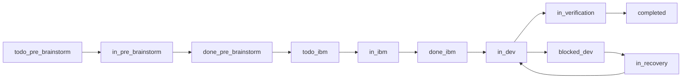

# Freely 法律

> 我是项目法律，只负责判定规则、验收证据、技能路由；不定义执行步骤。

---

## 1. 产品身份

判定规则：
1. 执行链保持“获取 Issue -> 文档 -> 开发 -> 验收 -> 获取 Issue”闭环。
2. 需求来源不退化为单一固定待办列表。
3. 无明确停止条件时维持自治循环与续接策略。
4. 新问题、编排入口、执行续接入口必须分层处理，不得混用。

最小验收证据：
- issue 来源记录
- 路由记录
- 回流后下一轮输入状态记录

执行技能：
- `skill:auto-loop-orchestrator`
- `skill:laws-enforcer`

---

## 2. 分支与工作树策略（硬性要求）

判定规则：
1. 分支来源、merge 方向、保护分支策略符合宪法分支表。
2. `feature/*` 默认从 `develop` 创建并在 worktree 内开发；若 issue 明确依赖未合并父分支改动，可从父 `feature/*` 派生 dedicated worktree，但必须记录依赖关系与最终集成目标。
3. `main/develop/pre-test-merge` 保持 add/commit 禁止。
4. `develop` 合并前，`TEST`（含集成验收）通过；若走 `pre-test-merge` 路径，验证批次必须可追溯。
5. `PRE_TEST` 仅作为开发前基线，不得替代提升测试结果。
6. 提升前必须有评审记录、祖先可追溯证据、进度/恢复更新证据。
7. merge/promotion/release 前执行 `./bin/wt-status-all`，结果全 `CLEAN`；cleanup 前至少要求 target worktree 自身安全。若存在 unrelated dirty 或 busy worktree，必须显式跳过并在 cleanup 证据中留痕，不得误删。
8. premerge 仅作冲突收敛，来源与回并目标均为当前活跃的 `pre-test-merge`。
9. 清理动作只能在 `verified-retirable` 后执行，且必须留痕。
10. 派生 worktree 的 issue 在提升前必须对齐其父分支结果：父分支先进入要求路径，子分支再 restack/rebase/merge 上游并重新验证。
11. `in_dev` issue 不得无限期累积脏树；当当前 worktree 进入 checkpoint 预警或阻断预算时，下一轮必须先更新对应 continuity artifact，并优先切出 checkpoint commit 或按 ownership 分流到其他 dedicated worktree。
12. runtime/status 必须暴露当前 project dirty entries 与项目级 worktree dirty summary，供多 worktree 监督与 promotion 决策使用。
13. 若当前工位已通过最小验证门，但仍持续扩写实现而不形成 checkpoint commit / checkpoint note，视为自治治理退化，不得宣称“工作正常”。

最小验收证据：
- 分支来源与合并路径记录
- `execution_base` / `integration_target` / `depends_on` 记录（如存在派生 worktree）
- `wt-status-all` 输出记录
- project dirty budget / worktree dirty summary 记录（如进入 checkpoint 治理）
- 测试、评审、进度/恢复证据
- 分支/worktree 清理记录

研究优先阶段的等价留痕：
- 若 `docs/progress/**` / `docs/recovery/**` 尚未启用，允许将验证批次、恢复上下文与 cleanup 结果记录到 `docs/pre-brainstorms/CONVERGENCE.md`
- 该临时落点只用于当前研究阶段；正式目录启用后，证据必须回到规范路径

执行技能：
- `skill:branch-management`
- `skill:multi-worktree-supervision`
- `skill:worktree-maintenance-governance`
- `skill:premerge-reconcile`
- `skill:constitution-guard`

---

## 2A. 来源与路由边界（硬性要求）

判定规则：
1. 原始发现源包括：`PROJECT_INTENT`、chat/session evidence、test、code-review、github-issue、治理漂移、运行时异常。
2. 原始发现源必须先在合适的 dedicated worktree 中进入 `pre-brainstorm`，产出 candidate，再由 milestone 承接；不得直接伪装成 ready issue。
3. `milestones.md` 是编排来源，不是原始发现源。
4. `milestone.candidate_issues` 只能继续研究或进入 IBM，不得默认直接进入 dev-loop。
5. `milestone.committed_issues` 才是 milestone-owned issue 的正式入口。
6. `progress` 与 `recovery` 属于延续来源；其中 `progress` 只跟踪 dev-loop 执行态。

最小验收证据：
- 来源分类记录
- candidate -> milestone 映射记录
- 路由决定与下一跳记录

执行技能：
- `skill:context-source-skill`
- `skill:doc-pre-brainstorm-execution`
- `skill:doc-ibm-execution`
- `skill:dev-loop-execution`

---

## 2B. IBM 与 Progress 边界（硬性要求）

判定规则：
1. `IBM` 中的 `I` 是 milestone-owned issue，而不是任意发现到的问题。正式 IBM 产物目录必须先确定为 `docs/epics/{epic-name}/{story-name}/...`。
2. candidate 未进入 milestone 前，不得声称已经进入 IBM。
3. `progress` 只跟踪 dev-loop 中的实现、测试、阻塞、恢复与回写，不跟踪 candidate 收敛或纯 IBM 文档收敛。
4. 若 dev-loop 暴露出边界外新问题，应回到 `pre-brainstorm`，而不是塞回当前 issue 进度。

最小验收证据：
- milestone-owned issue 记录
- `progress` 与 issue 状态一致性记录
- reroute 到 `pre-brainstorm` 的原因与证据

执行技能：
- `skill:doc-ibm-execution`
- `skill:dev-loop-execution`
- `skill:laws-enforcer`

---

## 2C. 状态同步与流程标识（硬性要求）

判定规则：
1. 以下流程标识的规范语义以本章为唯一事实源：
   - `source_class`: `discovery | milestone | continuation`
   - `route_kind`: `pre_brainstorm | ibm | dev_loop | completion_verification | recovery`
   - `phase_state`: `todo_pre_brainstorm | in_pre_brainstorm | done_pre_brainstorm | todo_ibm | in_ibm | done_ibm | in_dev | blocked_dev | in_verification | in_recovery | completed`
   - `runtime_state`: `attachable | resumable | restart_required | unavailable`
2. `candidate.status` 只用于 pre-brainstorm 阶段，建议值保持为 `proposed | needs_research | promoted | dropped`；不得拿它替代 issue 或 dev-loop 状态。
3. `milestone_state` 只表达 milestone 队列归属，建议值保持为 `candidate | committed | completed`；不得再拿它表达 IBM / dev / verification 阶段。
4. 任何跨环迁移都必须同步更新对应产物，最少遵循：
   - `discovery -> pre_brainstorm`：更新 `brainstorms.md`、`candidates.md`、`milestones.md.candidate_issues`，并使用 `phase_state=todo_pre_brainstorm | in_pre_brainstorm`
   - `candidate -> milestone-owned issue`：更新 `candidates.md.promoted_issue_path`、`docs/milestones.md.issue_path`、正式 `issue` 路径，并进入 `phase_state=in_ibm`
   - `in_ibm -> done_ibm`：更新 `issue`、`docs/milestones.md`，不得强制创建 `progress`
   - `done_ibm -> in_dev`：更新 `issue`、`docs/milestones.md`、`progress`
   - `in_dev -> blocked_dev`：更新 `issue`、`progress`、`docs/milestones.md`，并记录 blocker
   - `recovery`：更新 `progress` 或 `recovery`，并带回当前 `runtime_state` 与 `phase_state=in_recovery`
   - `in_verification -> completed`：更新 `issue`、`docs/milestones.md`、必要的 `progress/recovery` 完结记录，以及后续清理证据
5. `session_refs` 是跨环证据字段；当 candidate 进入 issue、issue 进入 dev-loop、或进入 recovery 时，必须把当前有效会话证据继续写入下一层产物。
6. `session_refs` 的最小字段为：
   - `tool`
   - `session_id`
   - `jsonl_path`
   - `role`
7. 若当前 AI 工具无法暴露 jsonl 文件路径，允许 `jsonl_path=unavailable://<reason>`，但不得省略 `session_id`。
8. milestone 可保留摘要字段如 `active_session_ref`，但完整会话证据的规范落点是 `candidates.md`、`issue`、`progress`、`recovery`。
9. 主执行标识不得再使用 `status=in_progress`、`status=completed`、`milestone_state=in_progress` 或 `pending_*` 这类泛化值；未开始但可推进统一使用 `todo_*`，等待外部条件统一使用 `blocked_*` 或独立依赖字段。
10. `phase_state=in_*` 只表示“上次已进入该阶段”，不保证当前进程仍在运行；auto-loop 必须结合 `runtime_state`、最近一次 `progress/recovery` 证据、以及当前会话可续接性二次判别。
11. 若条目停留在 `in_*`，但当前会话不可 attach/resume，或执行证据已经中断且未写回 `blocked_*`，不得直接当作健康执行中；必须先路由到 `recovery` 检查，再决定回到原 `in_*` 继续，还是显式改写为 `blocked_*`。
12. `blocked_*` 只用于 AI 已识别并显式留痕的业务阻塞；PID 消失、CLI 崩溃、会话断裂、监控探活失败等系统事件，不得直接写成 `blocked_*`。
13. 系统崩溃或 PID 消失后，恢复定位优先级固定为：`recovery -> progress -> issue -> milestone -> active worktree/uncommitted changes`；`milestone` 只用于发现活跃 issue，不作为恢复事实源。
14. 用于恢复和 resume 的最小字段除 `tool/session_id/jsonl_path/role` 外，还应尽量包含 `branch`、`worktree_path`、`phase_state`、`runtime_state`、`resume_hint`；若无法完整获得，必须至少保留可追溯的降级原因。
15. `resume` 只表示“当前工具会话技术上仍可续接”，不自动等于“继续 resume 是最优策略”；若运行时已出现 `context compacted`、连续 resume 退化或达到本地轮换阈值，应允许选择 `fresh_with_handoff`，而不是盲目继续旧会话。
16. `fresh_with_handoff` 的最小交接面应尽量包含：上一轮 `tool_session_id`（如可得）、上一轮 cycle log 路径、当前 branch/worktree、触发 fresh 的原因，以及最近一段可追溯输出摘录。
17. 若当前工具可提供结构化上下文使用证据（例如 Codex 的 `token_count` / `model_context_window`），runtime 应允许在真正 compact 之前基于本地阈值做容量治理，而不是只等 `context compacted` 后再被动轮换。
18. context-window 容量治理至少区分两档：
   - `warn`：下一轮先更新当前阶段对应的 continuity artifact，再继续当前 issue
   - `rotate`：下一轮直接进入 `fresh_with_handoff`
19. continuity artifact 的落点必须遵循 loop 分层，不得一律写成 `progress`：
   - `dev-loop` 写 `progress`
   - `doc-loop` 写当前 issue / IBM / pre-brainstorm 产物
   - `recovery` 写 `recovery` 或允许的等价恢复留痕
20. 若 runtime 无法直接知道当前 loop 的精确文档路径，至少必须把 `summary_target_hint` 写入 prompt / handoff，由当前 AI 在下一跳先补 continuity，再继续业务推进。

状态词图例：
- `todo_*`：下一阶段已确定，但尚未开始
- `in_*`：当前阶段执行中
- `done_*`：当前阶段完成，可流转到下一阶段
- `blocked_*`：当前阶段被阻塞，需先解阻或恢复
- `completed`：整个 issue 生命周期结束

状态流转图：

图示解释：
- 阶段交接统一通过 `done_* -> 下一个 in_*`
- `blocked_dev` 不是终态；恢复后回到 `in_dev` 继续
- 下次重新进入一个未完成 issue 时，若执行上下文仍可续接，应优先回到对应 `in_*`，而不是重新生成新的 `todo_*`
- 若 `in_*` 已陈旧且会话不可续接，先进入 `in_recovery` 做恢复判定；恢复成功再回原 `in_*`，恢复失败再落 `blocked_*`
- 系统监控发现 PID 消失时，先做恢复定位，不直接改 `phase_state`

最小验收证据：
- 流程标识词典记录
- 至少一条状态联动矩阵记录
- `session_refs` 结构化留痕
- `phase_state` 与 `progress` 一致性记录

执行技能：
- `skill:auto-loop-orchestrator`
- `skill:context-source-skill`
- `skill:doc-pre-brainstorm-execution`
- `skill:doc-ibm-execution`
- `skill:dev-loop-execution`
- `skill:recovery-subagent-governance`

---

## 3. 版本命名规则（硬性要求）

判定规则：
1. tag 命名格式为 `YYYY.MM.DD-HHMM-stage`。
2. 分支与 stage 映射符合宪法表。
3. `alpha`/`beta` 为本地 tag，不得 push。

最小验收证据：
- tag 列表与分支映射记录

执行技能：
- `skill:branch-management`
- `skill:laws-enforcer`

---

## 4. 强制技术栈

判定规则：
1. 未经修订，不得替换强制技术栈（Tauri/Rust/React/Bun/xterm.js/Rust PTY）。
2. 涉及替换时必须提供显式修订与迁移证据。

最小验收证据：
- 技术栈检查记录
- 修订说明（如有）

执行技能：
- `skill:constitution-guard`
- `skill:laws-enforcer`

---

## 5. 基线项目结构（硬性要求）

判定规则：
1. 项目至少满足宪法规定的基线结构。
2. 研究阶段允许最小 docs 集合，但必须保证可追溯证据不缺失。
3. 本阶段采用双轨验收：规范路径产物或等价可追溯证据，满足其一即可。

最小验收证据：
- 目录结构检查记录
- 等价证据索引（若未落规范路径）

执行技能：
- `skill:constitution-guard`
- `skill:laws-enforcer`

---

## 6. 终端架构规则

判定规则：
1. 终端通过 PTY 执行真实 shell。
2. 循环实例会话/PID/状态隔离。
3. 监控和恢复目标对齐 AI CLI 会话生命周期。

最小验收证据：
- PTY 执行证据
- 会话隔离与监控记录

执行技能：
- `skill:constitution-guard`
- `skill:recovery-subagent-governance`

---

## 7. AI 执行模式

判定规则：
1. AI 规格符合 `tool:model:mode`。
2. `mode` 语义不被破坏（`auto`/`step`）。

最小验收证据：
- 运行配置与模式记录

执行技能：
- `skill:constitution-guard`
- `skill:laws-enforcer`

---

## 8. 恢复策略（硬性要求）

判定规则：
1. 优先续接；不支持续接时执行桥接恢复。
2. 恢复记录必须含 branch/worktree/session 上下文。
3. 恢复后能回到可执行循环状态。
4. 额度耗尽、认证失败、账号不可用属于恢复治理，不得静默停机或高频空转重试。
5. 若工具支持多账号，runtime 必须优先使用非交互 CLI 切换可用账号；当全部账号都不可立即使用时，应切换到最早恢复的账号并 sleep 到 reset 时间。

最小验收证据：
- 续接或桥接记录
- 恢复检查点记录
- 账号切换或 reset backoff 记录（如适用）

执行技能：
- `skill:recovery-subagent-governance`
- `skill:auto-loop-orchestrator`

---

## 9. 约束面

判定规则：
1. 仅使用宪法定义输入面（路径/意图/宪法/AI 规格）。
2. 其他上下文通过项目文件发现，不走隐式注入。

最小验收证据：
- 输入参数白名单检查记录

执行技能：
- `skill:constitution-guard`
- `skill:laws-enforcer`

---

## 10. 工程纪律

判定规则：
1. 命令面可脚本化且确定性。
2. 状态可落盘且可检查。
3. `AGENTS.md` 在项目根存在并可用。
4. 代码与文档冲突时，先走代码/测试修复路径。
5. 规范文档改动必须在独立 `feature/*` + worktree 且绑定实现或门禁证据。
6. 任一法律门失败时必须阻断提升/发布，并记录修复路径。
7. 多 worktree 监督与 checkpoint 压力必须以 CLI 能力落地，不得只存在于聊天或人工观察中。
8. 主管工位必须能从 CLI 控制面主动识别“expected running but down”的 worker 异常；不能依赖人工手动运行状态检查后才发现 supervisor/worker 已失活。

最小验收证据：
- 命令与状态检查记录
- 违例记录与修复记录

执行技能：
- `skill:laws-enforcer`
- `skill:dev-loop-execution`

---

## 11. 方法论总述（硬性要求）

判定规则：
1. Doc-loop 产物完整（`IBM` 业务产物与 `G` 治理产物按 issue 范围满足其一或组合，并保持可追溯）。
2. Dev-loop 产物完整，且测试证据可追溯。
3. Auto-loop 路由可解释，回流状态正确。
4. `map` 阶段定义 `PRE_TEST` 基线，提升/合并阶段使用执行后的 `TEST` 结果。

最小验收证据：
- doc/dev/auto 三循环产物链
- 治理资产一致性证据（当 issue 触发治理维护时）
- 路由与状态链路记录

执行技能：
- `skill:doc-pre-brainstorm-execution`
- `skill:doc-ibm-execution`
- `skill:dev-loop-execution`
- `skill:auto-loop-orchestrator`
- `skill:laws-enforcer`

---

## 12. 子代理规划与委托（硬性要求）

判定规则：
1. 委托前有边界、完成标准、合并标准。
2. 父级对批次具备等待语义与收敛语义。
3. 子代理失败时有可追溯回退路径。

最小验收证据：
- 任务映射与完成状态记录
- 回退决策记录

执行技能：
- `skill:recovery-subagent-governance`
- `skill:laws-enforcer`

---

## 13. 并行开发的领域模型（硬性要求）

判定规则：
1. 物理领域：并行任务使用独立 worktree。
2. 逻辑领域：并行任务拥有明确文件/模块所有权边界。
3. 共享热点采用串行窗口或显式排序策略。

最小验收证据：
- 并行任务与 worktree 路径映射
- 文件/模块 ownership 边界记录
- 共享热点串行窗口或排序记录

执行技能：
- `skill:recovery-subagent-governance`
- `skill:laws-enforcer`

---

## 14. 可插拔模块架构与接口版本控制（硬性要求）

判定规则：
1. 接口版本策略明确。
2. 破坏性变更具备迁移与回滚路径。
3. 合约测试覆盖当前/候选实现。
4. 第三方 API 以提供方契约为外部事实源，本地实现做适配。

最小验收证据：
- 版本与迁移文档
- 合约测试记录

执行技能：
- `skill:module-interface-governance`

---

## 15. 变更前配置备份（硬性要求）

判定规则：
1. 配置修改前必须备份。
2. 备份名必须包含源文件基名、`.bak` 标记与 UTC 时间戳（`YYYYMMDD-HHMMSS`）。
3. 备份路径与恢复目标可追溯。

最小验收证据：
- 备份文件路径与时间记录

执行技能：
- `skill:config-backup-guard`

---

## 16. Freely 自举开发（硬性要求）

判定规则：
1. Freely 自身开发遵守同一治理链（意图/宪法/法律/skills）。
2. 架构治理变更先进入 pre-brainstorms，再进入 doc/dev 落地。
3. 工具链治理能力可复用到托管项目。

最小验收证据：
- pre-brainstorms -> doc/dev 落地链路
- 自举治理检查记录

执行技能：
- `skill:constitution-guard`
- `skill:branch-management`
- `skill:laws-enforcer`

---

## 附录 A. 执行路由（固定顺序）

默认执行链：
1. `skill:constitution-guard`（硬约束门禁）
2. `skill:laws-enforcer`（法律门禁与证据校验）
3. 业务技能（`auto/doc/dev/branch/...`；若独立调用，也必须先执行前两步）

说明：
- 法律只定义门与证据，不定义操作步骤。
- 操作步骤以 `docs/system/workspace/skills/` 为唯一执行事实源。

## 附录 B. 三层职责边界（宪法 / 法律 / skills）

1. 宪法（What/Why）：边界与原则，不写执行步骤。
2. 法律（Check/Accept/Route）：判定门、证据口径、技能路由，不写执行步骤。
3. skills（How）：可执行操作步骤，不扩展宪法边界、不替代法律验收。
4. skills 可在不冲突前提下补充实现细节（如依赖安装、配置引导、环境预检、修复脚本）；若该细节需成为强制放行门，必须回写法律章节。
