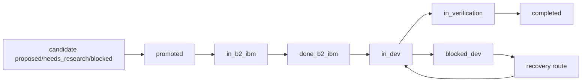

# Freely 法律

> 我是项目法律，只负责判定规则、验收证据、技能路由；不定义执行步骤。

---

## 1. 产品身份

判定规则：
1. 执行链保持“获取 Issue -> 文档 -> 开发 -> 验收 -> 获取 Issue”闭环。
2. 需求来源不退化为单一固定待办列表。
3. 无明确停止条件时维持自治循环与续接策略。
4. 新问题、编排入口、执行续接入口必须分层处理，不得混用。

最小验收证据：
- issue 来源记录
- 路由记录
- 回流后下一轮输入状态记录

执行技能：
- `skill:freely-auto-loop-orchestrator`
- `skill:freely-laws-enforcer`

---

## 1A. 三 Loop 主链 Trace（硬性要求）

判定规则：
1. 三个 loop 的可判定执行节点必须写 lifecycle 主链 trace，不得只靠自然语言日志。
2. 主链 trace 必须遵循 [three-loop-trace-contract](./system/workspace/three-loop-trace-contract.md)。
3. 每个节点至少写一对 `ph=IN` / `ph=OUT`，并显式标记：
   - `me`
   - `fr`
   - `to`
4. 非入口节点不得省略上游；真实入口只能标记为 `ENTRY`。
5. 非真实结束节点不得省略下一跳；真实结束只能标记为 `TERM`。
6. 新增或重排 loop 逻辑时，必须同步更新 checkpoint 编号与 handoff；不得产生匿名跳转。

最小验收证据：
- lifecycle trace 中可观察到稳定 checkpoint 编号
- 同一节点存在 `IN`/`OUT` 成对记录
- 下游 `IN ok` 能校验上游声明
- 断链时可从日志直接定位缺失或错链位置

---

## 2. 分支与工作树策略（硬性要求）

判定规则：
1. 分支来源、merge 方向、保护分支策略符合宪法分支表。
2. `feature/*` 默认从 `develop` 创建并在 worktree 内开发；若 issue 明确依赖未合并父分支改动，可从父 `feature/*` 派生 dedicated worktree，但必须记录依赖关系与最终集成目标。
3. `main/develop` 保持 add/commit 禁止（仅接受 merge）。`test-pre-merge-*` 允许 merge、cherry-pick（commit 内容来自 dev），允许直接修改文件（未提交、快速验证），禁止手动 `git add` + `git commit` 原创提交，且禁止 push。
4. `develop` 合并前，`TEST`（含集成验收）通过；`develop` 的正常合法来源是已通过 guarded PR/merge 的来源 `feature/*` / `fix/*` 与符合热修复规则的 `hotfix/*`。若经过 `test-pre-merge-*` 验证，当前批次必须可追溯到 single-feature lane 或 explicit multi-bundle 的来源 feature、source shas、merge order 与 base develop sha，但 `test-pre-merge-*` 本身不得作为 develop merge source。
4b. `test-pre-merge-*` 只承担主线前的临时验证职责，不承担“在 `develop` 上先预测试”的替代语义；需要主线前验证时，应进入新的 `test-pre-merge-*` 批次，需要主线后真实环境验收时，才进入 `develop` 的 completion verification。
4d. `develop` 在本地 merge 后允许存在短暂的 post-merge acceptance / cleanup followthrough 窗口；但若本地 `develop` 已领先其 tracked remote，这段窗口必须以显式的 status / patrol truth 暴露，不得静默假装已经完成远端 canonical followthrough。
4a. 当 issue 已有 `pre-tests.md` 时，develop 合并 gate 默认优先看其中定义的 integration / acceptance evidence；代码评审完成度不得替代这层验收。
4e. 测试 lane 必须与分支职责一致，至少区分三类：
   - `feature-local`：在 dedicated fix/feature/release/hotfix/premerge worktree 中运行实现自测、局部回归、issue-bound 验证；不得在 `main/develop/test-pre-merge-*` 上冒充此 lane。
   - `premerge-integration`：仅在 `test-pre-merge-*` 批次中运行主线前集成 smoke/regression/acceptance；不得在 `develop` 上提前执行来替代测试批次。
   - `post-merge-followthrough`：仅在目标 protected branch 的 canonical worktree 中运行 merge 后真实环境 followthrough；它观察集成结果，不授予继续在 protected branch 上开发实现的权限。
4f. 若使用统一测试入口，命令语义必须显式暴露 lane 与当前 branch 的匹配关系；lane 误用应直接失败，而不是静默降级到“能跑就算对”。
4g. 若 canonical `develop` 本地领先 tracked remote，任何依赖“当前最新 develop”作结论的判断都必须先消费 push/resync followthrough。runtime/status 至少要暴露 `develop_push_followthrough_push_urgency`、`develop_push_followthrough_resync_required` 与 push attempt truth，供 manager / patrol / active worker 拦截 latest-develop-sensitive judgment。`develop` 的 guarded merge 完成后允许自动发起一次受控 push attempt；若 attempt 失败，必须写回显式 `push_blocked` truth，不得静默回落成 generic `push_pending`，也不得在 hook/runtime 内无界重试直到成功。
4c. `pre-tests.md` 若不能恢复 acceptance contract，则不得被视为“测试已定义”。最低质量线至少包括：
   - acceptance target
   - testing layer
   - target environment
   - required evidence
   - blocker taxonomy
   最小 blocker taxonomy 至少区分：`definition_missing`、`commands_only`、`evidence_plan_missing`、`execution_pending_or_failed`。
5. `PRE_TEST` 仅作为开发前基线，不得替代提升测试结果。
6. 提升前必须有评审记录、祖先可追溯证据、进度/恢复更新证据。
7. merge/promotion/release 前执行 `./bin/wt-status-all`，结果全 `CLEAN`；cleanup 前至少要求 target worktree 自身安全。若存在 unrelated dirty 或 busy worktree，必须显式跳过并在 cleanup 证据中留痕，不得误删。
8. premerge 仅作冲突收敛，来源与回并目标均为当前活跃的 `test-pre-merge-*` 批次。
9. 清理动作只能在 `verified-retirable` 后执行，且必须留痕。
10. 派生 worktree 的 issue 在提升前必须对齐其父分支结果：父分支先进入要求路径，子分支再 restack/rebase/merge 上游并重新验证。
11. `in_dev` issue 不得无限期累积脏树；当当前 worktree 进入 checkpoint 预警或阻断预算时，下一轮必须先更新对应 continuity artifact，并优先切出 checkpoint commit 或按 ownership 分流到其他 dedicated worktree。
12. runtime/status 必须暴露当前 project dirty entries 与项目级 worktree dirty summary，供多 worktree 监督与 promotion 决策使用。
13. 若当前工位已通过最小验证门，但仍持续扩写实现而不形成 checkpoint commit / checkpoint note，视为自治治理退化，不得宣称“工作正常”。
14. `test-pre-merge-*` 作为临时预集成批次时，若 `develop` 已前进到使其不再权威、或批次出现 protected-env 独有差异、或 promotion/cleanup 证据断裂，则该批次应被判定为 stale 并立即删除；若仍需继续验证，必须从当前 `develop` 重建新批次。
15. `test-pre-merge-*` 的验证结论默认回到来源 feature/fix 的已验证结果；保留旧批次快照不是默认真相面，只有在当前批次仍然权威时才可继续消费。
16. `test-pre-merge-*` 不得承载 owner truth、issue continuation、milestone truth 或长期 cleanup 决策；若因为这些内容导致测试批次不能删除，默认判定为 misuse。

最小验收证据：
- 分支来源与合并路径记录（若经过 `test-pre-merge-*`，需包含测试批次标识、来源 feature/fix 顺序或 explicit multi-bundle 组装证据、回到来源分支的 guarded PR/merge 证据，以及该批次的删除 / 重建结论）
- `execution_base` / `integration_target` / `depends_on` 记录（如存在派生 worktree）
- `wt-status-all` 输出记录
- project dirty budget / worktree dirty summary 记录（如进入 checkpoint 治理）
- 测试、评审、进度/恢复证据
- 分支/worktree 清理记录

研究优先阶段的等价留痕：
- 若 `docs/progress/**` / `docs/recovery/**` 尚未启用，允许将验证批次、恢复上下文与 cleanup 结果记录到 `docs/B1-docs/CONVERGENCE.md`
- 该临时落点只用于当前研究阶段；正式目录启用后，证据必须回到规范路径

执行技能：
- `skill:freely-branch-management`
- `skill:freely-multi-worktree-supervision`
- `skill:freely-worktree-maintenance-governance`
- `skill:freely-premerge-reconcile`
- `skill:freely-constitution-guard`

---

## 2A. 来源与路由边界（硬性要求）

判定规则：
1. 原始发现源包括：`PROJECT_INTENT`、comment/discuss session evidence、test、code-review、github-issue、治理漂移、运行时异常。
2. 原始发现源必须先在合适的 dedicated worktree 中进入 `pre-brainstorm`，产出 candidate，再由 milestone 承接；不得直接伪装成 ready issue。
3. `milestones.md` 是编排来源，不是原始发现源。
4. `milestone.candidate_issues` 只能继续研究或进入 B2，不得默认直接进入 dev-loop。
5. `milestone.committed_issues` 才是 milestone-owned issue 的正式入口。
6. `progress` 与 `recovery` 属于延续来源；其中 `progress` 只跟踪 dev-loop 执行态。
7. 研究项若当前仍不能收口，不得因为本轮未继续实现而静默消失；必须继续留在 `candidates.md` 与 `milestones.md.candidate_issues` 或等价的 issue-bound 挂起产物中，并写清 `next_action` 与重启条件。

最小验收证据：
- 来源分类记录
- candidate -> milestone 映射记录
- 路由决定与下一跳记录

执行技能：
- `skill:freely-context-source-skill`
- `skill:freely-doc-B1_IBM-execution`
- `skill:freely-doc-B2_IBM-execution`
- `skill:freely-dev-loop-execution`

---

## 2B. B2 与 Progress 边界（硬性要求）

判定规则：
1. `B2_IBM` 中的 `I` 是 milestone-owned issue，而不是任意发现到的问题。正式 B2_IBM 产物目录必须先确定为 `docs/B2-docs/{epic-name}/{story-name}/...`。
2. candidate 未进入 milestone 前，不得声称已经进入 B2_IBM。
3. `progress` 只跟踪 dev-loop 中的实现、测试、阻塞、恢复与回写，不跟踪 candidate 收敛或纯 B2 文档收敛。
4. 若 dev-loop 暴露出边界外新问题，应回到 `pre-brainstorm`，而不是塞回当前 issue 进度。

最小验收证据：
- milestone-owned issue 记录
- `progress` 与 issue 状态一致性记录
- reroute 到 `pre-brainstorm` 的原因与证据

执行技能：
- `skill:freely-doc-B2_IBM-execution`
- `skill:freely-dev-loop-execution`
- `skill:freely-laws-enforcer`

---

## 2B.1 Freely 自身产品架构讨论的分类与对齐（硬性要求）

判定规则：
1. Freely 自举中出现的新讨论，先判定它属于：
   - 现有 issue continuation
   - Freely 自身产品架构
   - Freely 开发治理
   - Freely 可复用能力
2. 若属于 Freely 自身产品架构，首轮正式落点应为：
   - `PROJECT_INTENT.md`
   - `CONSTITUTION.md`
   - `LAWS.md`
   - `AGENTS.md`
3. Freely 自身产品架构 discussion 默认不得直接写入 `docs/system/**`；只有当后续被独立抽象成可复用能力后，才另开生命周期进入能力目录。
4. 例外：若某份 `docs/system/**` 文档已经被 `PROJECT_INTENT / LAWS / agents / skills` 明确共同指定为 whole-app lifecycle / logic 的唯一细节真源，则它可以承载该层系统行为地图；当前例外仅指 `docs/system/workspace/three-loop-capability-lifecycle.md`。
5. 对这个 whole-app lifecycle 真源：
   - `PROJECT_INTENT / CONSTITUTION / LAWS` 只保留原则、边界、状态词典、判定门与摘要引用
   - agents / skills / scripts 不得各自平行维护 three-loop 细节流程、route map 或 terminal semantics
   - 涉及 three-loop routing、loop placement、completion / verification / cleanup / recovery judgment 的实现或提示词变更前，必须先阅读并理解该真源
   - 若这些语义发生变化，变更必须同步检查并按需更新该真源，再更新引用面
6. 当 Freely 自身产品架构表达更新时，必须至少检查：
   - 当前 pre-brainstorm / candidate / issue / progress 是否与新的职责分工一致
   - 是否仍有文档把 semantic surfaces 与 host shells 混层
   - 是否仍有文档把 Freely 自身产品形态直接写成 Freely 通用能力
7. `AGENTS.md` 在这类变更中只承担开发入口判断，不替代 `PROJECT_INTENT / CONSTITUTION / LAWS` 的架构本体职责。

最小验收证据：
- 分类记录
- `PROJECT_INTENT / CONSTITUTION / LAWS / AGENTS.md` 对齐记录
- 至少一轮相关 repo 文档 sweep 记录
- 若命中 whole-app lifecycle 真源例外，还需证明引用面已回退为摘要/引用，而不是继续平行维护细节

执行技能：
- `skill:freely-laws-enforcer`
- `skill:freely-doc-B1_IBM-execution`
- `skill:freely-doc-B2_IBM-execution`

---

## 2C. 状态同步与流程标识（硬性要求）

判定规则：
1. 以下流程标识的规范语义以本章为唯一事实源：
   - `source_class`: `discovery | milestone | continuation`
   - `route_kind`: `b2 | dev_loop | completion_verification | recovery`
   - raw issue `phase_state`: `proposed | absorbed | dropped`
   - linked issue `phase_state`: `in_b2_ibm | done_b2_ibm | in_dev | blocked_dev | in_verification | completed`
   - `recovery` 是 route/runtime 状态，不写入 linked issue `phase_state`
   - `runtime_state`: `attachable | resumable | restart_required | unavailable`
2. `candidate.status` 只用于 pre-brainstorm 阶段，建议值保持为 `proposed | needs_research | blocked | promoted | absorbed | dropped`；不得拿它替代 issue 或 dev-loop 状态。
2a. merge 到 `develop` 前，candidate 是否允许“没有下一环”只能由当前 `candidate.status` 判定：
   - `proposed | needs_research | blocked`：允许暂时没有正式 B2 issue，但必须继续保留在 `docs/milestones.md.candidate_issues`，并写清 `next_action` 与 `revisit_trigger`
   - `promoted`：不允许缺下一环；必须已经 materialize 为一个或多个 `I-{issue-id}*`
   - `absorbed`：允许不新开独立 issue，但必须明确写出吸收它的 owner issue 或等价 canonical owner
   - `dropped`：允许不进入下一环，但必须写清 `decision_reason`
2b. active unresolved candidate 的 milestone 放置也属于硬性治理要求：
   - `proposed | needs_research | blocked` 不得保持 `milestone: unassigned`、`pending://milestone-binding`，也不得挂入已 `completed` 的 milestone
   - `candidates.md.milestone` 必须与 `docs/milestones.md` 中实际承接它的 `M-*` 一致
   - 若当前 milestone 已明确不消费某条 `needs_research` candidate，必须显式决定：继续留在当前 milestone、谨慎后移到更合适且仍 active 的 milestone，或直接 `dropped`
   - 后移只允许发生在“已知更早会消费它的后续 active milestone”上；不得为了保持表面可见而把 candidate 长期停放到模糊远期 milestone
3. `milestone_state` 只表达 milestone 队列归属，建议值保持为 `candidate | committed | completed`；不得再拿它表达 B2 / dev / verification 阶段。
4. 任何跨环迁移都必须同步更新对应产物，最少遵循：
   - `discovery -> pre_brainstorm`：更新 `brainstorms.md`、`candidates.md`、`milestones.md.candidate_issues`，并使用 `candidate.status=proposed | needs_research | blocked`
   - `candidate → milestone → I-* issue`（四节点链路）：`freely-doc-B1_IBM-execution` skill 把 candidate（`C-{key}-A`）接入 milestone（`M-{key}-A`，写入 milestones.md candidate_issues）；`freely-doc-B2_IBM-execution` skill 把该 `M-{key}-A` materialize 成 I-* issue（`I-{key}-A`），物化到 `docs/B2-docs/{epic-name}/{story-name}/raw-{raw key}/issues/`，并同步更新 milestones.md committed_issues，然后进入 `phase_state=in_b2_ibm`
   - `in_b2_ibm -> done_b2_ibm`：更新 `issue`、`docs/milestones.md`，不得强制创建 `progress`
   - `done_b2_ibm -> in_dev`：更新 `issue`、`docs/milestones.md`、`progress`
   - `in_dev -> blocked_dev`：更新 `issue`、`progress`、`docs/milestones.md`，并记录 blocker
   - `recovery`：更新 `progress` 或 `recovery`，并带回当前 `runtime_state` 与原 linked issue `phase_state`；不得把恢复路线写成 linked issue `phase_state=in_recovery`
   - `in_verification -> completed`：更新 `issue`、`docs/milestones.md`、必要的 `progress/recovery` 完结记录，以及后续清理证据
4a. 对 `pre-brainstorm -> candidate -> milestone -> issue -> progress/recovery -> completed/cleanup` 这条链，应按“治理事务”理解：只有相关 canonical artifacts 都同步后，当前迁移才算完成；不得只改其中一个文档就声称已完成收口。
4b. `M-{key}-A` 是 milestone 容器节点（candidate_issues 持有 C-{key}-A），不等于最终执行编排身份；一旦 `freely-doc-B2_IBM-execution` skill materialization 产出 `I-{key}-A`（committed_issues），milestone 的正式编排必须从 `M-{key}-A` 候选位切到 `I-{key}-A`，原始 `M-{key}-A` 只保留来源与追溯语义。
5. `session_refs` 是跨环证据字段；当 candidate 进入 issue、issue 进入 dev-loop、或进入 recovery 时，必须把当前有效会话证据继续写入下一层产物。
6. `session_refs` 的最小字段为：
   - `tool`
   - `session_id`
   - `jsonl_path`
   - `role`
7. 若当前 AI 工具无法暴露 jsonl 文件路径，允许 `jsonl_path=unavailable://<reason>`，但不得省略 `session_id`。
8. milestone 可保留摘要字段如 `active_session_ref`，但完整会话证据的规范落点是 `candidates.md`、`issue`、`progress`、`recovery`。
8a. future pre-brainstorm candidate 应使用 `candidate_format_version: v2`，并至少包含：
   - `acceptance_criteria`
   - `promotion_gate`
   - `open_questions`
   - `acceptance_reviews`
8b. `acceptance_criteria` / `promotion_gate` / `open_questions` 属于 candidate-level acceptance boundary，不等于 issue / dev / verification 的实现验收。
8c. `candidate_format_version: v2` 的 candidate 若进入 promotion 决策，至少应有一次独立 acceptance review 记录；高风险 candidate 优先多个 subagent 或 fresh process review。
8d. 进入 B2 后，必须把 candidate-level acceptance 深化为 issue-level acceptance，并反映在 issue / `prd.md` / `pre-tests.md` / `tasks.md` / issue-bound brainstorm 中。
8e. develop-bound implementation-bearing work（首批至少包括 `bin/`、`docs/system/`、`src/` 下的 capability materialization）必须在当前 owner issue 的 `verification_artifact_dir` 下写一份 issue-bound implementation decision note；该 note 是 dev-loop thoughtfulness 的 canonical surface，不得随机落点或复制成平行真相。最小字段至少包括：
   - `decision`
   - `why_this`
   - `alternatives_considered`
   - `boundary_non_goals`
   - `residual_risk`
   其他产物可以引用该 note，但不得代替它成为主真源。
9. 主执行标识不得再使用 `status=in_progress`、`status=completed`、`milestone_state=in_progress` 或 `pending_*` 这类泛化值；未开始但可推进统一使用 `todo_*`，等待外部条件统一使用 `blocked_*` 或独立依赖字段。
10. `phase_state=in_*` 只表示“上次已进入该阶段”，不保证当前进程仍在运行；auto-loop 必须结合 `runtime_state`、最近一次 `progress/recovery` 证据、以及当前会话可续接性二次判别。
11. 若条目停留在 `in_*`，但当前会话不可 attach/resume，或执行证据已经中断且未写回 `blocked_*`，不得直接当作健康执行中；必须先路由到 `recovery` 检查，再决定回到原 `in_*` 继续，还是显式改写为 `blocked_*`。
12. `blocked_*` 只用于 AI 已识别并显式留痕的业务阻塞；PID 消失、CLI 崩溃、会话断裂、监控探活失败等系统事件，不得直接写成 `blocked_*`。
13. 系统崩溃或 PID 消失后，恢复定位优先级固定为：`recovery -> progress -> issue -> milestone -> active worktree/uncommitted changes`；`milestone` 只用于发现活跃 issue，不作为恢复事实源。
14. 用于恢复和 resume 的最小字段除 `tool/session_id/jsonl_path/role` 外，还应尽量包含 `branch`、`worktree_path`、`phase_state`、`runtime_state`、`resume_hint`；若无法完整获得，必须至少保留可追溯的降级原因。
15. `resume` 只表示“当前工具会话技术上仍可续接”，不自动等于“继续 resume 是最优策略”；若运行时已出现 `context compacted`、连续 resume 退化或达到本地轮换阈值，应允许选择 `fresh_with_handoff`，而不是盲目继续旧会话。
16. `fresh_with_handoff` 的最小交接面应尽量包含：上一轮 `tool_session_id`（如可得）、上一轮 cycle log 路径、当前 branch/worktree、触发 fresh 的原因，以及最近一段可追溯输出摘录。
17. 若当前工具可提供结构化上下文使用证据（例如 Codex 的 `token_count` / `model_context_window`），runtime 应允许在真正 compact 之前基于本地阈值做容量治理，而不是只等 `context compacted` 后再被动轮换。
18. context-window 容量治理至少区分两档：
   - `warn`：下一轮先更新当前阶段对应的 continuity artifact，再继续当前 issue
   - `rotate`：下一轮直接进入 `fresh_with_handoff`
19. continuity artifact 的落点必须遵循 loop 分层，不得一律写成 `progress`：
   - `dev-loop` 写 `progress`
   - `doc-loop` 写当前 issue / B2_IBM / pre-brainstorm 产物
   - `recovery` 写 `recovery` 或允许的等价恢复留痕
20. 若 runtime 无法直接知道当前 loop 的精确文档路径，至少必须把 `summary_target_hint` 写入 prompt / handoff，由当前 AI 在下一跳先补 continuity，再继续业务推进。
21. `needs_research` 或其他未收口 candidate 不得脱离 milestone 可见队列；除非显式写成 `dropped` 或已 materialize 为 milestone-owned issue，否则必须保留在 `milestones.md.candidate_issues`，并具备可执行的 `next_action` 与 `revisit_trigger` 或等价字段。
21a. `needs_research` 保持可见不等于可以永久挂起；若当前 milestone 已确认本轮不会消费，必须在当前轮明确做出“留当前 milestone / 后移到更合适的 active milestone / dropped”三选一决策，并把原因写回 canonical artifacts。

状态词图例：
- `proposed | needs_research | blocked | promoted | absorbed | dropped`：candidate / raw issue 收敛状态，按产物类型解释
- `in_b2_ibm | done_b2_ibm | in_dev | blocked_dev | in_verification | completed`：linked issue 生命周期状态
- `in_*`：当前阶段已进入；是否仍有活跃进程必须结合 `runtime_state` 与 evidence 判断
- `done_*`：当前阶段完成，可流转到下一阶段
- `blocked_*`：当前阶段被阻塞，需先解阻或恢复
- `completed`：整个 linked issue 生命周期结束

状态流转图：

图示解释：
- 阶段交接统一通过 `done_* -> 下一个 in_*`
- `blocked_dev` 不是终态；恢复后回到 `in_dev` 继续
- 下次重新进入一个未完成 issue 时，若执行上下文仍可续接，应优先回到对应 `in_*`，而不是重新生成新的 `todo_*`
- 若 `in_*` 已陈旧且会话不可续接，先进入 recovery route 做恢复判定；恢复成功再回原 `in_*`，恢复失败再落 `blocked_*`
- 系统监控发现 PID 消失时，先做恢复定位，不直接改 `phase_state`

最小验收证据：
- 流程标识词典记录
- 至少一条状态联动矩阵记录

---

## 2D. Protected-Branch Hook/Gate Bypass Governance（硬性要求）

判定规则：
1. `main` / `develop` / `test-pre-merge-*` 上的 hook/gate bypass 永久禁止，无例外。
2. `AGENTS.md`、skills、hook 提示文案都不是允许 bypass 的权威来源。
3. `FREELY_SKIP_IBM_GATE="违规绕过门禁中，理由充分，是：<业务理由>"` 是唯一合法的门禁豁免机制：仅跳过 IBM governance 文档门禁，保留安全/分支保护门禁。仅限 document|cleanup|format 等结构上不需要 IBM lifecycle 证据的变更。
4. `--no-verify`、`git commit --no-verify`、`git merge --no-verify` 或任何等价手动绕过手段永久禁止。
5. 受控 completion path 不能只靠环境变量自报身份；必须同时留下 hook 可验证的 machine-readable guarded completion state。
6. `pr-merge-guarded` 是 protected-branch merge receipt 的唯一 canonical 入口。所有 protected-branch merge 必须通过此路径。
7. `governance-check` 或等价 canonical quality gate 必须能审计当前 protected-branch merge receipt；缺少 receipt 或 receipt 不完整时，不得宣称治理完成。
8. 下列情形永远不能构成合法 bypass：
   - 赶时间、想先合并再说
   - "我已经人工看过了"
   - 只是 docs / cleanup / writeback，小改动应该没关系
   - hook 文案看起来像误报，但没有保留失败证据
   - 为了继续在 protected branch 上开发或追加额外修改
   - gate 误判 → 应修正 gate 模式，不得绕过

merge receipt 字段（写入 protected-branch merge commit message）：
- `Freely-Merge-Path`
- `Freely-Bypass-Mode`（永远为 `forbidden`）
- `Freely-Source-Branch`

执行技能：
- `skill:freely-branch-management`
- `skill:freely-constitution-guard`
- `skill:freely-laws-enforcer`

---

## 3. 版本命名规则（硬性要求）

判定规则：
1. tag 命名格式为 `YYYY.MM.DD-HHMM-stage`。
2. 分支与 stage 映射符合宪法表。
3. `alpha`/`beta` 为本地 tag，不得 push。

最小验收证据：
- tag 列表与分支映射记录

执行技能：
- `skill:freely-branch-management`
- `skill:freely-laws-enforcer`

---

## 4. 强制技术栈

判定规则：
1. 未经修订，不得替换强制技术栈（Tauri/Rust/React/Bun/xterm.js/Rust PTY）。
2. 涉及替换时必须提供显式修订与迁移证据。

最小验收证据：
- 技术栈检查记录
- 修订说明（如有）

执行技能：
- `skill:freely-constitution-guard`
- `skill:freely-laws-enforcer`

---

## 5. 基线项目结构（硬性要求）

判定规则：
1. 项目至少满足宪法规定的基线结构。
2. 研究阶段允许最小 docs 集合，但必须保证可追溯证据不缺失。
3. 本阶段采用双轨验收：规范路径产物或等价可追溯证据，满足其一即可。

最小验收证据：
- 目录结构检查记录
- 等价证据索引（若未落规范路径）

执行技能：
- `skill:freely-constitution-guard`
- `skill:freely-laws-enforcer`

---

## 6. 终端架构规则

判定规则：
1. 终端通过 PTY 执行真实 shell。
2. 循环实例会话/PID/状态隔离。
3. 监控和恢复目标对齐 AI CLI 会话生命周期。

最小验收证据：
- PTY 执行证据
- 会话隔离与监控记录

执行技能：
- `skill:freely-constitution-guard`
- `skill:freely-recovery-subagent-governance`

---

## 7. AI 执行模式

判定规则：
1. AI 规格符合 `tool:model:mode`。
2. `mode` 语义不被破坏（`auto`/`step`）。

最小验收证据：
- 运行配置与模式记录

执行技能：
- `skill:freely-constitution-guard`
- `skill:freely-laws-enforcer`

---

## 8. 恢复策略（硬性要求）

判定规则：
1. 优先续接；不支持续接时执行桥接恢复。
2. 恢复记录必须含 branch/worktree/session 上下文。
3. 恢复后能回到可执行循环状态。
4. 额度耗尽、认证失败、账号不可用属于恢复治理，不得静默停机或高频空转重试。
5. 若工具支持多账号，runtime 必须优先使用非交互 CLI 切换可用账号；当全部账号都不可立即使用时，应切换到最早恢复的账号并 sleep 到 reset 时间。

最小验收证据：
- 续接或桥接记录
- 恢复检查点记录
- 账号切换或 reset backoff 记录（如适用）

执行技能：
- `skill:freely-recovery-subagent-governance`
- `skill:freely-auto-loop-orchestrator`

---

## 9. 约束面

判定规则：
1. 仅使用宪法定义输入面（路径/意图/宪法/AI 规格）。
2. 其他上下文通过项目文件发现，不走隐式注入。

最小验收证据：
- 输入参数白名单检查记录

执行技能：
- `skill:freely-constitution-guard`
- `skill:freely-laws-enforcer`

---

## 10. 工程纪律

判定规则：
1. 命令面可脚本化且确定性。
2. 状态可落盘且可检查。
3. `AGENTS.md` 在项目根存在并可用。
4. 代码与文档冲突时，先走代码/测试修复路径。
5. 规范文档改动必须在独立 `feature/*` + worktree 且绑定实现或门禁证据。
6. 任一法律门失败时必须阻断提升/发布，并记录修复路径。
7. 多 worktree 监督与 checkpoint 压力必须以 CLI 能力落地，不得只存在于聊天或人工观察中。
8. 主管工位必须能从 CLI 控制面主动识别“expected running but down”的 worker 异常；不能依赖人工手动运行状态检查后才发现 supervisor/worker 已失活。

最小验收证据：
- 命令与状态检查记录
- 违例记录与修复记录

执行技能：
- `skill:freely-laws-enforcer`
- `skill:freely-dev-loop-execution`

---

## 10A. Freely 自身产品架构分类与对齐

判定规则：
1. Freely 自举中出现新讨论时，先判断它是：
   - 现有 issue continuation
   - Freely 自身产品架构
   - Freely 开发治理
   - Freely 可复用能力
2. 若是 Freely 自身产品架构，首个正式产物必须先回写：
   - `docs/PROJECT_INTENT.md`
   - `docs/CONSTITUTION.md`
   - `docs/LAWS.md`
   - `AGENTS.md`
3. `AGENTS.md` 只负责开发入口判断顺序，不得替代高层架构真源。
4. 不得把 Freely 自身产品架构讨论直接写入 `docs/system/**`，除非已经另外收敛成可复用能力。
5. 若从产品架构讨论中发现潜在通用能力，必须新开独立 pre-brainstorm，不得在原产品架构 issue 中偷渡泛化。

最小验收证据：
- `PROJECT_INTENT / CONSTITUTION / LAWS / AGENTS.md` 对齐写回
- milestone / issue / candidate 路径回写
- 如存在能力化分流，提供独立 pre-brainstorm 证据

执行技能：
- `skill:freely-laws-enforcer`
- `skill:freely-constitution-guard`

---

## 11. 方法论总述（硬性要求）

判定规则：
1. Doc-loop 产物完整（`B2_IBM` 业务产物与 `G` 治理产物按 issue 范围满足其一或组合，并保持可追溯）。
2. Dev-loop 产物完整，且测试证据可追溯。
3. Auto-loop 路由可解释，回流状态正确。
4. `map` 阶段定义 `PRE_TEST` 基线，提升/合并阶段使用执行后的 `TEST` 结果。

最小验收证据：
- doc/dev/auto 三循环产物链
- 治理资产一致性证据（当 issue 触发治理维护时）
- 路由与状态链路记录

执行技能：
- `skill:freely-doc-B1_IBM-execution`
- `skill:freely-doc-B2_IBM-execution`
- `skill:freely-dev-loop-execution`
- `skill:freely-auto-loop-orchestrator`
- `skill:freely-laws-enforcer`

---

## 12. 子代理规划与委托（硬性要求）

判定规则：
1. 委托前有边界、完成标准、合并标准。
2. 父级对批次具备等待语义与收敛语义。
3. 子代理失败时有可追溯回退路径。

最小验收证据：
- 任务映射与完成状态记录
- 回退决策记录

执行技能：
- `skill:freely-recovery-subagent-governance`
- `skill:freely-laws-enforcer`

---

## 13. 并行开发的领域模型（硬性要求）

判定规则：
1. 物理领域：并行任务使用独立 worktree。
2. 逻辑领域：并行任务拥有明确文件/模块所有权边界。
3. 共享热点采用串行窗口或显式排序策略。

最小验收证据：
- 并行任务与 worktree 路径映射
- 文件/模块 ownership 边界记录
- 共享热点串行窗口或排序记录

执行技能：
- `skill:freely-recovery-subagent-governance`
- `skill:freely-laws-enforcer`

---

## 14. 可插拔模块架构与接口版本控制（硬性要求）

判定规则：
1. 接口版本策略明确。
2. 破坏性变更具备迁移与回滚路径。
3. 合约测试覆盖当前/候选实现。
4. 第三方 API 以提供方契约为外部事实源，本地实现做适配。

最小验收证据：
- 版本与迁移文档
- 合约测试记录

执行技能：
- `skill:freely-module-interface-governance`

---

## 15. 变更前配置备份（硬性要求）

判定规则：
1. 配置修改前必须备份。
2. 备份名必须包含源文件基名、`.bak` 标记与 UTC 时间戳（`YYYYMMDDTHHMMSSZ`，旧格式 `YYYYMMDD-HHMMSS` 仍兼容）。
3. 备份路径与恢复目标可追溯。

最小验收证据：
- 备份文件路径与时间记录

执行技能：
- `skill:freely-config-backup-guard`

---

## 16. Freely 自举开发（硬性要求）

判定规则：
1. Freely 自身开发遵守同一治理链（意图/宪法/法律/skills）。
2. 架构治理变更先进入 pre-brainstorms，再进入 doc/dev 落地。
3. 工具链治理能力可复用到托管项目。

最小验收证据：
- pre-brainstorms -> doc/dev 落地链路
- 自举治理检查记录

执行技能：
- `skill:freely-constitution-guard`
- `skill:freely-branch-management`
- `skill:freely-laws-enforcer`

---

## 附录 A. 执行路由（固定顺序）

默认执行链：
1. `skill:freely-constitution-guard`（硬约束门禁）
2. `skill:freely-laws-enforcer`（法律门禁与证据校验）
3. 业务技能（`auto/doc/dev/branch/...`；若独立调用，也必须先执行前两步）

说明：
- 法律只定义门与证据，不定义操作步骤。
- 操作步骤以 `docs/system/workspace/skills/` 为唯一执行事实源。

## 附录 B. 三个 Loop 的职责边界（宪法 / 法律 / skills）

1. 宪法（What/Why）：边界与原则，不写执行步骤。
2. 法律（Check/Accept/Route）：判定门、证据口径、技能路由，不写执行步骤。
3. skills（How）：可执行操作步骤，不扩展宪法边界、不替代法律验收。
4. skills 可在不冲突前提下补充实现细节（如依赖安装、配置引导、环境预检、修复脚本）；若该细节需成为强制放行门，必须回写法律章节。
