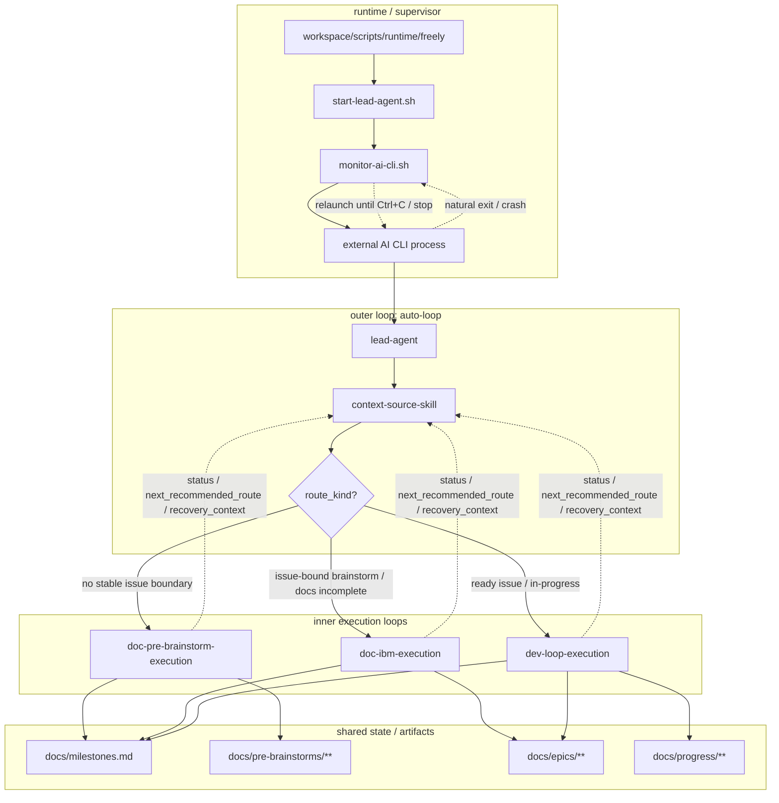

# Freely 项目意图

> 我是项目意图，指引方向，阐述为何而做。

## 核心目标

构建一个 Jarvis 式自主循环运行器：
- 启动后 AI 担任项目所有者角色。
- AI 从项目意图、story-scoped code-reviews、test、开发进度文档、chat 输入与会话证据（人类或自治）中产出或修改候选 Issue；从 github-issue、里程碑文档获取 Issue；而非固定从单一任务列表
- AI 自主管理：获取 Issue → 文档 → 开发 → 验收 → 获取 Issue 的闭环
- AI 持续运行（自己监控ai工具崩溃/阻塞自动触发续接），除非明确停止。或找不到需求，或者出现重大事故 AI 自己已经无力自己解决。

## 方法论总述

### 三层循环方法论

```text
A:auto-loop（外循环）
│
├── lead-agent（首跳代理）
│   └── 调用 context-source-skill
│
├── context-source-skill（路由决策）
│   ├── 扫描需求池：milestones/progress/code-reviews/test/chat/github-issue
│   ├── 判定 route_kind
│   └── 组装下一跳提示词
│
├── D:doc-pre-brainstorm-execution（前置收敛环）
│   ├── 触发条件：无稳定 issue 边界
│   └── 产出：
│       - docs/pre-brainstorms/<id>/brainstorms.md
│       - docs/pre-brainstorms/<id>/candidates.md
│       - docs/milestones.md（candidate 同步）
│
├── D:doc-ibm-execution（Issue-bound 文档收敛环）
│   ├── 触发条件：issue-bound brainstorm / docs incomplete
│   └── 产出（IBM + G）：
│       - docs/epics/{epic}/{story}/issues/{issue-name}.md
│       - docs/epics/{epic}/{story}/brainstorms/b-{issue-name}.md
│       - docs/epics/{epic}/{story}/prd.md
│       - docs/epics/{epic}/{story}/pre-tests.md
│       - docs/epics/{epic}/{story}/tasks.md
│       - docs/milestones.md（issue 同步）
│       - （按需）docs/CONSTITUTION.md, docs/LAWS.md, docs/system/workspace/skills/**
│
├── D:dev-loop-execution（开发实现环）
│   ├── 触发条件：ready issue / in-progress
│   └── 产出：
│       - src/**, tests/**
│       - docs/epics/{epic}/{story}/code-reviews/*.md
│       - docs/progress/{epic}/p-{issue}.md
│       - docs/milestones.md（状态更新）
│
└── 回流（状态交还 auto-loop）
    └── status / next_recommended_route / recovery_context
```

### 补充图：三层循环架构



### Issue 路由规则

| Issue 来源 | 路由起点 | 说明 |
|-----------|---------|------|
| pre-brainstorms 候选 | doc-ibm-execution | 候选 issue 需收敛并落位到 epic/story/milestone |
| 进度文档（未完成） | dev-loop-execution | 文档已有，继续开发 |
| 里程碑（待处理） | doc-ibm-execution 或 dev-loop-execution | 视文档完整度 |
| 项目意图（新需求） | doc-pre-brainstorm-execution | 前置研究收敛 |
| code-reviews/test（Bug/改进） | doc-ibm-execution 或 dev-loop-execution | 视复杂度与边界 |
| 治理漂移（宪法/法律/skills 不一致） | doc-ibm-execution | 先修治理一致性，再回到业务路由 |
| github-issue（外部输入） | doc-pre-brainstorm-execution | 先进入前置研究 |
| Chat 输入/会话证据（人类或自治） | doc-pre-brainstorm-execution | 先进入前置研究，再产出候选 Issue |

### Chat 输入与会话证据（人类/自治）

```
人类 ←──→ Chat Session ←──→ AI
              │
              ├── 讨论先沉淀到 pre-brainstorms/*/brainstorms.md
              ├── 候选项写入 pre-brainstorms/*/candidates.md
              ├── 多 AI/子代理会话日志以 jsonl 作为 session evidence
              └── 在 candidates.md 的 session_refs 留痕并进入 A2 路由
```

### 闭环理念

```
文档指导开发 → 开发反馈文档 → 循环直到完成
     ↑                              │
     └────────── 闭环 ──────────────┘
```

## 操作模式

1. **宪法约束的自主性**
   - 宪法是硬性约束面
   - 分支/工作树规则、技术栈约束、方法论约束

2. **单会话运行**
   - 每个运行实例拥有一个活动 AI CLI 进程/会话
   - 监控目标：该进程/会话生命周期

3. **恢复优先的连续性**
   - 支持无人值守续接时直接续接
   - 不支持时执行桥接步骤：更新进度文档，重启无人值守循环

4. **最小输入面**
   - 四个必需输入：
     - 项目绝对路径
     - 项目意图路径
     - 宪法路径
     - AI 规格 `tool:model:mode`
   - AI 自主发现其他项目文档

## 非目标

- 不是静态待办列表执行器
- 不是一次性命令运行器
- 不是人类驱动的工单机器人
