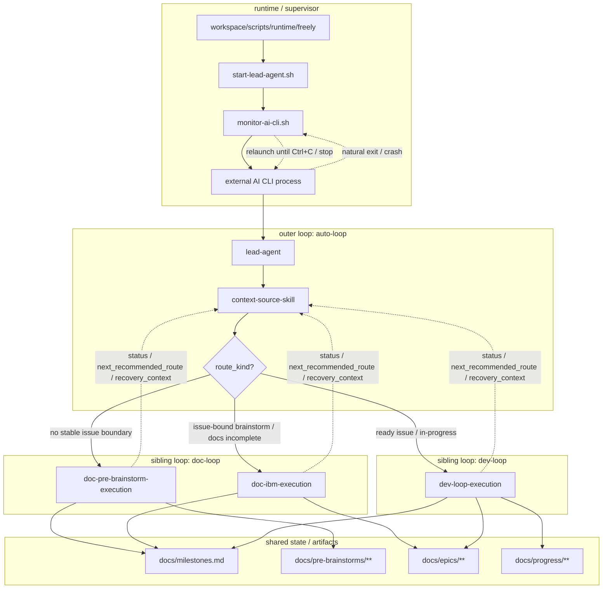

# Freely 项目意图

> 我是项目意图，指引方向，阐述为何而做。

## 核心目标

构建一个 Jarvis 式自主循环运行器：
- 启动后 AI 担任项目所有者角色。
- AI 从项目意图、story-scoped code-reviews、test、chat 输入与会话证据（人类或自治）、github-issue、治理漂移、运行时异常中发现新问题，并先收敛为 candidate；从里程碑文档获取已接纳 issue，从进度/恢复文档续接已有 issue；而非固定从单一任务列表
- AI 自主管理：获取 Issue → 文档 → 开发 → 验收 → 获取 Issue 的闭环
- AI 持续运行（自己监控ai工具崩溃/阻塞自动触发续接），除非明确停止。或找不到需求，或者出现重大事故 AI 自己已经无力自己解决。
- Freely 开发 Freely 时暴露的可复现共性问题，默认先判断是否应成为 Freely 能力发现；若可泛化到用户项目，应进入三个 loop 的 canonical lifecycle materialize 为可复用能力，而不是停留成一次性项目经验。

## 方法论总述

### 三个 Loop 方法论

说明：
- 本节定义 Freely 为什么需要三个 loop，以及高层闭环结构。
- 三个 loop 的能力归宿、owner 边界与生命周期细节真源统一收敛到 `docs/system/workspace/three-loop-capability-lifecycle.md`，避免在多个高层文档中重复维护。

```text
A:auto-loop（外层编排 / 治理 loop）
├── lead-agent（首跳代理）
│   └── 调用 context-source-skill
├── context-source-skill（路由决策）
│   ├── 扫描需求池：milestones/progress/code-reviews/test/chat/github-issue
│   ├── 判定 route_kind / worktree action
│   └── 组装下一跳提示词
├── sibling loop 1: doc-loop
│   ├── D:doc-pre-brainstorm-execution（前置收敛）
│   └── D:doc-ibm-execution（Issue-bound 文档收敛）
├── sibling loop 2: dev-loop-execution（开发实现）
├── verification / recovery / cleanup evidence 回流
├── auto-loop 基于 canonical evidence 做完成判定 / 验证裁决 / cleanup 路由
└── 状态交还 auto-loop，进入下一轮 orchestration 或结束当前 lifecycle
```

### 补充图：三个 Loop 架构



### 来源与路由规则

说明：
- 本节保留高层来源到下一跳的方向性约束。
- 详细 capability -> loop -> owner -> artifact -> transition 映射以 `docs/system/workspace/three-loop-capability-lifecycle.md` 为准。
- 其中 `doc-loop` 与 `dev-loop` 是 sibling execution loops；`dev-loop` 是 AI-native 能力实现层，不限于传统“写代码”；凡是在既有 issue 边界内把能力真正 materialize 出来的工作，都属于 `dev-loop`。
- `doc-loop` / `dev-loop` 负责推进与产出 evidence；最终的 completion / verification / cleanup judgment 由 `auto-loop` 负责。

| 来源 | 路由起点 | 说明 |
|-----------|---------|------|
| 项目意图（新需求） | doc-pre-brainstorm-execution | 前置研究收敛 |
| Chat 输入/会话证据（人类或自治） | doc-pre-brainstorm-execution | 先进入前置研究，再产出候选 Issue |
| github-issue（外部输入） | doc-pre-brainstorm-execution | 先进入前置研究 |
| code-reviews/test（Bug/改进） | doc-ibm-execution 或 dev-loop-execution | 视复杂度与边界 |
| 治理漂移（宪法/法律/skills 不一致） | doc-ibm-execution | 先修治理一致性，再回到业务路由 |
| 运行时异常 | doc-pre-brainstorm-execution 或 recovery-subagent-governance | 新异常先前置研究；已有中断上下文则进入恢复治理 |
| pre-brainstorms 候选 | doc-ibm-execution | 候选 issue 需收敛并落位到 epic/story/milestone |
| 里程碑 `candidate_issues` | doc-pre-brainstorm-execution 或 doc-ibm-execution | 仍需研究则回前置收敛；边界已清晰则进入 IBM |
| 里程碑 `committed_issues` | doc-ibm-execution 或 dev-loop-execution | 视 docs 完整度与 `phase_state` 决定进入 IBM、dev-loop 或 completion verification |
| 里程碑 `completed_issues` | completion_verification | 不重复执行，只做校验、追溯或必要的重新发现 |
| issue 文档 | doc-ibm-execution 或 dev-loop-execution | 缺 IBM 产物则回文档环；文档齐备则进入开发环 |
| 进度文档（未完成） | dev-loop-execution | `progress` 只跟踪 dev-loop 的实现/测试/阻塞/恢复 |
| recovery 记录 | recovery-subagent-governance | 先恢复到中断前的执行上下文，再回到对应 pre/doc/dev 环 |

流程标识词典与状态联动矩阵的规范语义统一见 `docs/LAWS.md` 第 2C 章；其中 issue / progress 的主执行标识统一使用 `phase_state`，skills 与 milestone policy 不得再自行发明同名状态。

### Chat 输入与会话证据（人类/自治）

```
人类 ←──→ Chat Session ←──→ AI
              │
              ├── 讨论先沉淀到 pre-brainstorms/*/brainstorms.md
              ├── 候选项写入 pre-brainstorms/*/candidates.md
              ├── 多 AI/子代理会话日志以 jsonl 作为 session evidence
              └── 在 candidates.md / issue / progress / recovery 中持续维护 `session_refs`
```

说明：
- `session_refs` 至少记录 `tool`、`session_id`、`jsonl_path`、`role`
- 若当前工具无法暴露 jsonl 路径，允许 `jsonl_path=unavailable://<reason>`，但不得省略 `session_id`

### 闭环理念

```
文档指导开发 → 开发反馈文档 → 循环直到完成
     ↑                              │
     └────────── 闭环 ──────────────┘
```

## 操作模式

1. **宪法约束的自主性**
   - 宪法是硬性约束面
   - 分支/工作树规则、技术栈约束、方法论约束

2. **单会话运行**
   - 每个运行实例拥有一个活动 AI CLI 进程/会话
   - 监控目标：该进程/会话生命周期

3. **恢复优先的连续性**
   - 支持无人值守续接时直接续接
   - 不支持时执行桥接步骤：更新进度文档，重启无人值守循环

4. **最小输入面**
   - 四个必需输入：
     - 项目绝对路径
     - 项目意图路径
     - 宪法路径
     - AI 规格 `tool:model:mode`
   - AI 自主发现其他项目文档

## 非目标

- 不是静态待办列表执行器
- 不是一次性命令运行器
- 不是人类驱动的工单机器人
