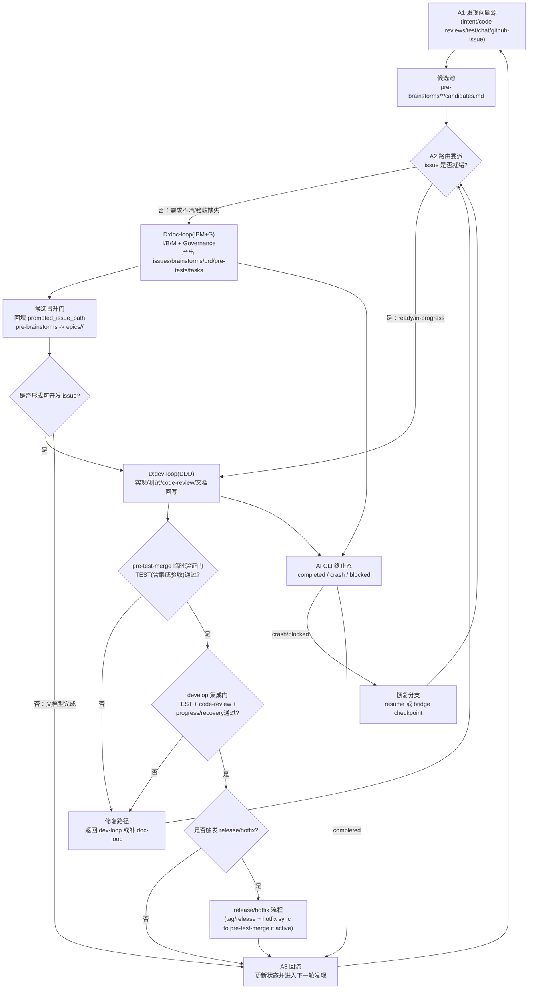

# Freely 项目意图

> 我是项目意图，指引方向，阐述为何而做。

## 核心目标

构建一个 Jarvis 式自主循环运行器：
- 启动后 AI 担任项目所有者角色。
- AI 从项目意图、story-scoped code-reviews、test、chat 输入与会话证据（人类或自治）、github-issue、治理漂移、运行时异常中发现新问题，并先收敛为 candidate；从里程碑文档获取已接纳 issue，从进度/恢复文档续接已有 issue；而非固定从单一任务列表
- AI 自主管理：获取 Issue → 文档 → 开发 → 验收 → 获取 Issue 的闭环
- AI 持续运行（自己监控ai工具崩溃/阻塞自动触发续接），除非明确停止。或找不到需求，或者出现重大事故 AI 自己已经无力自己解决。

## 方法论总述

### 三层循环方法论（统一循环图 + 产出物）

```text
A:auto-loop(ADD) [外循环]
│
├── A1 发现问题（持续）
│   ├── 原始发现源：intent/code-reviews/test/chat/github-issue/governance-drift/runtime-failure -> pre-brainstorms
│   ├── 编排源：milestones
│   └── 延续源：issue/progress/recovery
│   产出：
│   - docs/pre-brainstorms/<YYYYMMDD-HHMM--topic>/brainstorms.md
│   - docs/pre-brainstorms/<YYYYMMDD-HHMM--topic>/candidates.md
│
├── A2 分流决策
│   ├── raw problem -> D:pre-brainstorm
│   ├── milestone-owned issue but docs incomplete -> D:doc-loop(IBM+G)
│   └── ready issue / in-progress -> D:dev-loop(DDD)
│   产出：
│   - 更新 docs/pre-brainstorms/<YYYYMMDD-HHMM--topic>/candidates.md 的 route/status
│
├── D:doc-loop(IBM+G) [I -> B -> M + Governance]
│   产出（重构目标目录）：
│   - docs/epics/{epic-name}/{story-name}/issues/{issue-name}.md
│   - docs/epics/{epic-name}/{story-name}/brainstorms/b-{issue-name}.md
│   - docs/epics/{epic-name}/{story-name}/prd.md
│   - docs/epics/{epic-name}/{story-name}/pre-tests.md
│   - docs/epics/{epic-name}/{story-name}/tasks.md
│   - docs/milestones.md  (与 milestone-owned issue 原子同步写入：新增/调整归属)
│   - （按需）docs/CONSTITUTION.md, docs/LAWS.md, docs/system/workspace/skills/** 治理一致性修复
│   目录分层说明：
│   - pre-brainstorms/**：候选与前置收敛（未正式归属 story 前）
│   - epics/{epic-name}/{story-name}/**：正式 story 产物（归属后长期维护）
│
├── D:dev-loop(DDD) [Doc-Read -> Dev-Do -> Doc-Update]
│   产出：
│   - src/** , tests/**
│   - docs/epics/{epic-name}/{story-name}/code-reviews/*.md
│   - docs/progress/{epic-name}/p-{issue-name}.md  (只跟踪 dev-loop 执行态)
│   - docs/milestones.md  (状态更新)
│   - docs/epics/{epic-name}/{story-name}/issues/{issue-name}.md  (状态更新)
│
└── A3 回流
    └── 返回 A1，继续发现与完成
```

### 补充图：路由委派与业务流转闭环（查漏版）



### 来源与路由规则

| 来源 | 路由起点 | 说明 |
|-----------|---------|------|
| 项目意图 / chat / github-issue / test / code-review / 治理漂移 / 运行时异常 | D:pre-brainstorm | 原始发现源先进入 pre-brainstorms，再产出候选 candidate |
| pre-brainstorms 候选 | D:doc-loop(B/M) | 候选需先进入 milestone，再进入 IBM |
| 里程碑 `candidate_issues` | D:pre-brainstorm 或 D:doc-loop(M) | 不能默认直接开发；先判断是否仍需研究或已可进入 IBM |
| 里程碑 `committed_issues` | D:doc-loop(M) 或 D:dev-loop | milestone-owned issue 的正式入口，视 docs 完整度决定 |
| 里程碑 `completed_issues` | completion verification / 回流 | 不重复执行 |
| issue 文档 | D:doc-loop(M) 或 D:dev-loop | 继续已有 issue，视 docs 完整度决定 |
| 进度文档（未完成） | D:dev-loop | `progress` 只跟踪 dev-loop 的实现/测试/阻塞/恢复 |
| recovery 记录 | 回原环 | 恢复到中断前的 pre/doc/dev 环 |

### Chat 输入与会话证据（人类/自治）

```
人类 ←──→ Chat Session ←──→ AI
              │
              ├── 讨论先沉淀到 pre-brainstorms/*/brainstorms.md
              ├── 候选项写入 pre-brainstorms/*/candidates.md
              ├── 多 AI/子代理会话日志以 jsonl 作为 session evidence
              └── 在 candidates.md 的 session_refs 留痕，进入 milestone 承接后再继续 A2 路由
```

### 闭环理念

```
文档指导开发 → 开发反馈文档 → 循环直到完成
     ↑                              │
     └────────── 闭环 ──────────────┘
```

## 操作模式

1. **宪法约束的自主性**
   - 宪法是硬性约束面
   - 分支/工作树规则、技术栈约束、方法论约束

2. **单会话运行**
   - 每个运行实例拥有一个活动 AI CLI 进程/会话
   - 监控目标：该进程/会话生命周期

3. **恢复优先的连续性**
   - 支持无人值守续接时直接续接
   - 不支持时执行桥接步骤：更新进度文档，重启无人值守循环

4. **最小输入面**
   - 四个必需输入：
     - 项目绝对路径
     - 项目意图路径
     - 宪法路径
     - AI 规格 `tool:model:mode`
   - AI 自主发现其他项目文档

## 非目标

- 不是静态待办列表执行器
- 不是一次性命令运行器
- 不是人类驱动的工单机器人
