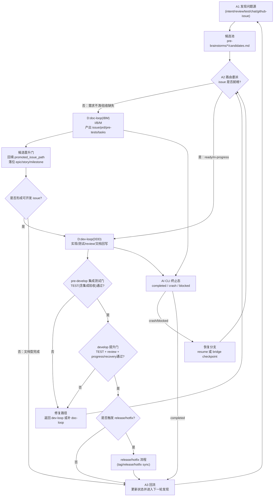

# Freely 项目意图

> 我是项目意图，指引方向，阐述为何而做。

## 核心目标

构建一个 Jarvis 式自主循环运行器：
- 启动后 AI 担任项目所有者角色。
- AI 从项目意图、review、test、开发进度文档、chat-todo，自己思考产出或修改 Issue；从 github-issue、里程碑文档，获取 Issue；而非固定从单一任务列表
- AI 自主管理：获取 Issue → 文档 → 开发 → 验收 → 获取 Issue 的闭环
- AI 持续运行（自己监控ai工具崩溃/阻塞自动触发续接），除非明确停止。或找不到需求，或者出现重大事故 AI 自己已经无力自己解决。

## 方法论总述

### 三层循环方法论（统一循环图 + 产出物）

```text
A:auto-loop(ADD) [外循环]
│
├── A1 发现问题（持续）
│   ├── 新问题源：intent/review/test/chat/github-issue -> pre-brainstorms
│   ├── 候选源：pre-brainstorms/candidates
│   └── 执行源：milestones/progress(未完成)
│   产出：
│   - docs/pre-brainstorms/<YYYYMMDD-HHMM--topic>/brainstorms.md
│   - docs/pre-brainstorms/<YYYYMMDD-HHMM--topic>/candidates.md
│
├── A2 分流决策
│   ├── raw problem / candidate -> D:doc-loop(IBM)
│   └── ready issue / in-progress -> D:dev-loop(DDD)
│   产出：
│   - 更新 docs/pre-brainstorms/<YYYYMMDD-HHMM--topic>/candidates.md 的 route/status
│
├── D:doc-loop(IBM) [I -> B -> M]
│   产出（重构目标目录）：
│   - docs/epics/{epic}/{story}/issues/{issue}.md
│   - docs/epics/{epic}/{story}/prd.md
│   - docs/epics/{epic}/{story}/pre-tests.md
│   - docs/epics/{epic}/{story}/tasks.md
│   - docs/milestones.md  (与 issue 原子同步写入：新增/调整归属)
│
├── D:dev-loop(DDD) [Doc-Read -> Dev-Do -> Doc-Update]
│   产出：
│   - src/** , tests/**
│   - docs/progress/{epic}/p-{issue}.md
│   - docs/milestones.md  (状态更新)
│   - docs/epics/{epic}/{story}/issues/{issue}.md  (状态更新)
│
└── A3 回流
    └── 返回 A1，继续发现与完成
```

### 补充图：路由委派与业务流转闭环（查漏版）



### Issue 路由规则

| Issue 来源 | 路由起点 | 说明 |
|-----------|---------|------|
| pre-brainstorms 候选 | D:doc-loop(B/M) | 候选 issue 需收敛并落位到 epic/story/milestone |
| 进度文档（未完成） | D:dev-loop | 文档已有，继续开发 |
| 里程碑（待处理） | D:doc-loop(M) 或 D:dev-loop | 视文档完整度 |
| 项目意图（新需求） | D:doc-loop(I) | 从接入开始 |
| review/test（Bug/改进） | D:doc-loop(B) 或 D:dev-loop | 视复杂度 |
| github-issue（外部输入） | D:doc-loop(I) | 从接入开始 |
| Chat Todo（人类介入） | 视情况 | 人类产出或修改 Issue |

### Chat Todo（人类介入）

```
人类 ←──→ Chat Session ←──→ AI
              │
              ├── AI 通过 Chat 思考产出讨论文档
              ├── 基于讨论结果生成 chat-todo
              ├── 基于 chat-todo 产生或修改 Issue
              └── 更新 chat-todo 使用状态
```

### 闭环理念

```
文档指导开发 → 开发反馈文档 → 循环直到完成
     ↑                              │
     └────────── 闭环 ──────────────┘
```

## 操作模式

1. **宪法约束的自主性**
   - 宪法是硬性约束面
   - 分支/工作树规则、技术栈约束、方法论约束

2. **单会话运行**
   - 每个运行实例拥有一个活动 AI CLI 进程/会话
   - 监控目标：该进程/会话生命周期

3. **恢复优先的连续性**
   - 支持无人值守续接时直接续接
   - 不支持时执行桥接步骤：更新进度文档，重启无人值守循环

4. **最小输入面**
   - 四个必需输入：
     - 项目绝对路径
     - 项目意图路径
     - 宪法路径
     - AI 规格 `tool:model:mode`
   - AI 自主发现其他项目文档

## 非目标

- 不是静态待办列表执行器
- 不是一次性命令运行器
- 不是人类驱动的工单机器人
