# Three-Loop Capability Lifecycle

本文件是 Freely whole-app lifecycle / logic 的唯一细节真源。

> **注意**: Mermaid 时序图已不反映 chat-inbox 架构（chat 不再直接写 `docs/issues/` 而是走 `.freely/freely.db`）。
> 图的语义保真度已下降，计划后续用 SVG 重绘。当前以 `docs/system/workspace/ibm-framework.md` 和 `docs/pre-brainstorms/20260429-2040--chat-inbox-sqlite/brainstorms.md` 为准。

凡是会改变 three-loop routing、loop placement、completion / verification / cleanup / recovery judgment 的实现、prompt、agent、skill 或高层文档，在修改前都必须先阅读并理解本文件；若语义变化，必须同步检查并按需更新本文件，再更新引用面。

```mermaid
sequenceDiagram
    participant AUTO as auto-loop
    participant DOC as doc-loop
    participant DEV as dev-loop

    Note over AUTO: Freely 启动首跳<br/>`freely start` / runtime restart / global restart restore
    AUTO->>AUTO: [脚本 do]：<br/>启动 runtime<br/>校验项目锚点 / AGENTS / hooks / 最小状态面
    AUTO->>AUTO: [脚本 do]：<br/>拉起 supervisor / interruption dispatcher / watchdog / lead-agent 首跳
    AUTO->>AUTO: [脚本 do]：<br/>进入 signal intake 与 source patrol 监听态<br/>等待 event-driven / patrol-driven 信号进入

    alt event-driven 信号/来源池
        Note over AUTO: 人类插话 / runtime anomaly / worker 新发现<br/>未被当前 issue 吸收的 review/test 新信号<br/>已 closeout 后再次暴露的 review/test 新发现
        AUTO->>AUTO: [脚本 do]：<br/>接住 event-driven signal<br/>记录 durable signal
    else patrol-driven 信号/来源池
        Note over AUTO: milestone 未收口 / progress 未完成 / pre-brainstorm 未产出<br/>GitHub/Gitee raw issue 未被 canonical linkage 消费<br/>GitHub/Gitee linked issue 仍 open 但 canonical closeout 未闭合 / cleanup 尾项
        AUTO->>AUTO: [脚本 do]：<br/>运行 `freely task-source-scan --json`<br/>生成 standing-source inventory
        AUTO->>AUTO: [脚本 do]：<br/>接住 patrol-derived signal<br/>记录 durable signal
    end

    alt 命中 runtime-owned failure
        AUTO->>AUTO: [脚本 do]：<br/>AI 工具或外部工具阻塞 / 崩溃 / 死循环且 AI 无法自行处理<br/>先执行恢复 / 重启 / kill-restart / 等待重检
        AUTO->>AUTO: [脚本 do]：<br/>恢复后重回 intake gate
    else 可进入主管 routing gate
        AUTO->>AUTO: [脚本 do]：<br/>触发主管轮次<br/>提供 lifecycle 真相 / runtime 真相 / 当前工位真相 / 工具可用性
        AUTO->>AUTO: [脚本 do]：<br/>提供最新 task-source-scan JSON<br/>供主管做 standing-source first-hop
        AUTO->>AUTO: [主管AI do]：<br/>notice 来源<br/>需要时先 claim
        AUTO->>AUTO: [主管AI do]：<br/>读取真相<br/>做 intent understanding
        AUTO->>AUTO: [主管AI do]：<br/>调用 context-source-skill<br/>做 source classification<br/>区分 discovery / milestone / continuation
        AUTO->>AUTO: [主管AI do]：<br/>识别 restart point<br/>判断复用/新开/冻结/退休工位
        AUTO->>AUTO: [主管AI do]：<br/>判断进入哪个 loop / gate
        AUTO->>AUTO: [主管AI do]：<br/>需要时把 candidate 接入 milestone 的 M-*<br/>未收口 candidate 继续留在 candidate_issues 可见队列
    end

    alt 判断为进入 pre-brainstorm
        AUTO->>DOC: [主管AI do]：<br/>进入 doc-loop<br/>进入条件：边界未稳 / 新发现 / candidate 未收口<br/>进入目标：收敛边界 / 补 candidate / 补 next action
        loop doc-loop 内部循环
            DOC->>DOC: [worker AI do]：<br/>读取来源上下文<br/>读取边界<br/>读取验收
            loop doc-loop pre-brainstorm 子循环
                DOC->>DOC: [worker AI do]：<br/>补 pre-brainstorm
                DOC->>DOC: [worker AI do]：<br/>补 candidate<br/>补 next action<br/>补 revisit trigger
                DOC->>DOC: [worker AI do]：<br/>补 acceptance 边界<br/>补 milestone 可见性
            end
            DOC->>DOC: [worker AI do]：<br/>判断当前边界是否稳定
        end
        alt 判断为边界已稳定且回写完成
            DOC-->>AUTO: [worker AI do]：<br/>返回 auto-loop<br/>返回条件：边界已稳定且回写完成<br/>返回材料：candidate / milestone / acceptance / next action 已回写
        else 判断为仍需继续当前循环
            DOC->>DOC: [worker AI do]：<br/>继续 doc-loop 内部循环
        else 判断为暴露新边界或新发现
            DOC-->>AUTO: [worker AI do]：<br/>返回 auto-loop<br/>返回条件：暴露新边界或新发现<br/>返回材料：需要 auto-loop 重判下一跳 / 工位
        end
    else 判断为进入 doc-loop issue materialization / B2_IBM
        AUTO->>DOC: [主管AI do]：<br/>进入 doc-loop<br/>进入条件：milestone 已承接且 issue docs / acceptance 未收稳<br/>进入目标：补 B2_IBM / 补 acceptance contract / 让 issue ready
        Note over AUTO,DOC: 工位 / 分支 / worktree 仍是局部治理约束<br/>跟随 issue-ready handoff 收纳，不单独长成新生命周期分支
        loop doc-loop B2_IBM 内部循环
            DOC->>DOC: [worker AI do]：<br/>读取 issue / B2_IBM / acceptance
            DOC->>DOC: [worker AI do]：<br/>把 milestone 的 M-* materialize 为 I-*<br/>同步 issue_path / milestone 回写
            DOC->>DOC: [worker AI do]：<br/>C-* 继续保留 candidate mirror 语义<br/>I-* 成为当前执行编排 owner
            DOC->>DOC: [worker AI do]：<br/>补 issue-bound docs<br/>补 acceptance contract
            DOC->>DOC: [worker AI do]：<br/>补 pre-tests / tasks / issue-bound brainstorm
            DOC->>DOC: [worker AI do]：<br/>判断 issue docs / acceptance 是否已收稳
        end
        alt 判断为 issue docs 已收稳且回写完成
            DOC-->>AUTO: [worker AI do]：<br/>返回 auto-loop<br/>返回条件：issue docs 已收稳且当前 issue ready<br/>返回材料：issue / milestone / acceptance / pre-tests 已回写
        else 判断为仍需继续当前循环
            DOC->>DOC: [worker AI do]：<br/>继续 doc-loop B2_IBM 循环
        else 判断为暴露新边界或新发现
            DOC-->>AUTO: [worker AI do]：<br/>返回 auto-loop<br/>返回条件：暴露新边界或新发现<br/>返回材料：需要 auto-loop 重判下一跳 / 工位
        end
    else 判断为进入 dev-loop execution
        AUTO->>DEV: [主管AI do]：<br/>进入 dev-loop<br/>进入条件：issue ready / continuation<br/>进入目标：实现当前批次 / 补测试 / 补 evidence
        Note over AUTO,DEV: add / commit / 局部分支推进属于当前 issue 的实现与证据动作<br/>不单独长成平行生命周期轴
        loop dev-loop 内部循环
            DEV->>DEV: [worker AI do]：<br/>确认当前 issue / 工位 / 依赖 / 当前批次目标
            loop dev-loop 实现子循环
                DEV->>DEV: [worker AI do]：<br/>改代码<br/>改脚本<br/>改 runtime<br/>改 agent
                DEV->>DEV: [worker AI do]：<br/>自检当前实现批次<br/>是否还需继续
            end
            loop dev-loop 验证与证据子循环
                DEV->>DEV: [worker AI do]：<br/>跑测试
                DEV->>DEV: [worker AI do]：<br/>消化当前 issue 内部的 test failure / review feedback
                DEV->>DEV: [worker AI do]：<br/>写 progress
                DEV->>DEV: [worker AI do]：<br/>写 evidence
                DEV->>DEV: [worker AI do]：<br/>写 verification_artifact_dir 下的 implementation decision note
                DEV->>DEV: [worker AI do]：<br/>补 code-review / verification artifact
                DEV->>DEV: [worker AI do]：<br/>需要时做 add / commit / worktree 内续推
                DEV->>DEV: [worker AI do]：<br/>判断当前批次证据是否足够
            end
        end
        alt 判断为当前批次 evidence 已就绪
            DEV-->>AUTO: [worker AI do]：<br/>返回 auto-loop<br/>返回条件：当前批次 evidence 已就绪<br/>返回材料：tests / progress / evidence / implementation note 已回写
        else 判断为仍需继续当前循环
            DEV->>DEV: [worker AI do]：<br/>继续 dev-loop 内部循环
        else 判断为当前边界不够用
            DEV-->>AUTO: [worker AI do]：<br/>返回 auto-loop<br/>返回条件：发现当前边界不够用<br/>返回材料：需要 auto-loop 重判下一跳 / 工位
        end
    else 判断为进入 recovery
        AUTO->>AUTO: [主管AI do]：<br/>进入 recovery gate
        AUTO->>AUTO: [脚本 do]：<br/>提供中断态 / 恢复态 / 工具可用性
        AUTO->>AUTO: [主管AI do]：<br/>按 recovery -> progress -> issue -> milestone 顺序读取恢复真相<br/>重建当前 runtime_state / phase_state / 可续接性
        AUTO->>AUTO: [主管AI do]：<br/>判断恢复后跳去哪里
        alt 判断为接回原 loop / 原工位
            AUTO->>AUTO: [主管AI do]：<br/>按原 loop / 原工位继续推进
        else 判断为跳去 doc-loop
            AUTO->>DOC: [主管AI do]：<br/>跳去 doc-loop<br/>进入目标：重收边界 / 补 continuity / 重启文档推进
        else 判断为跳去 dev-loop
            AUTO->>DEV: [主管AI do]：<br/>跳去 dev-loop<br/>进入目标：重启实现批次 / 补 continuity / 继续推进
        else 判断为继续等待
            AUTO->>AUTO: [脚本 do]：<br/>继续 runtime-owned 等待 / 重试 / 重检<br/>等待下一轮巡检
        end
    end

    AUTO->>AUTO: [主管AI do]：<br/>读取回写 / 读取证据 / 读取 review signal<br/>判断返回后跳去哪里
    Note over AUTO: review / verification / cleanup / closeout 继续作为 auto-loop 回收后的判断面<br/>不再拆成彼此竞争的平行主轴
    alt 判断为跳去 dev-loop
        AUTO->>DEV: [主管AI do]：<br/>跳去 dev-loop<br/>进入条件：实现需修正 / 证据未收够 / 当前 issue 仍可继续<br/>进入目标：继续实现 / 补测试 / 补证据
    else 判断为跳去 doc-loop
        AUTO->>DOC: [主管AI do]：<br/>跳去 doc-loop<br/>进入条件：边界变化 / acceptance 需重写 / issue docs 未收稳<br/>进入目标：重收边界 / 补 B2_IBM / 补 closeout docs
    else 判断为形成新发现源
        AUTO->>DOC: [主管AI do]：<br/>跳去 doc-loop<br/>进入条件：当前 issue 已完成且新发现不再属于原 issue<br/>进入目标：形成新的 candidate / GitHub issue / milestone intake
    else 判断为进入 completion verification
        AUTO->>AUTO: [主管AI do]：<br/>进入 completion verification gate<br/>进入条件：当前 issue 已达到 completion verification 条件<br/>进入目标：校验当前回写 / 证据 / completion judgment
        alt 判断为跳去 doc-loop 补文档收口
            AUTO->>DOC: [主管AI do]：<br/>跳去 doc-loop<br/>进入目标：补 closeout docs / 补 writeback / 补追溯
        else 判断为跳去 dev-loop 补开发收口
            AUTO->>DEV: [主管AI do]：<br/>跳去 dev-loop<br/>进入目标：补实现尾项 / 补验证 / 补 cleanup evidence
        else 判断为进入 cleanup / closeout followthrough
            AUTO->>AUTO: [主管AI do]：<br/>进入 cleanup / closeout followthrough gate<br/>读取 cleanup 尾项 / 提升条件 / 退休条件<br/>处理 merge / promotion / cleanup / writeback 尾项
            alt 判断为仍有 cleanup 尾项
                AUTO->>AUTO: [主管AI do]：<br/>继续 auto-loop 收口<br/>补排班 / 补跟进
            else 判断为已提升待退休或进入下一轮巡检
                AUTO->>AUTO: [脚本 do]：<br/>退出条件：cleanup / 提升 / 退休尾项已闭合<br/>退出期望：结束当前轮次并进入下一轮巡检
            end
        end
    else 判断为继续等待
        AUTO->>AUTO: [主管AI do]：<br/>判断是否委派<br/>是否复用工位<br/>是否冻结等待
        AUTO->>AUTO: [脚本 do]：<br/>等待回写<br/>等待新信号<br/>等待下一轮巡检
    end
```

Note：角色不另起泳道， 只在步骤里标成 [脚本 do]： [主管AI do]： [worker AI do]：

