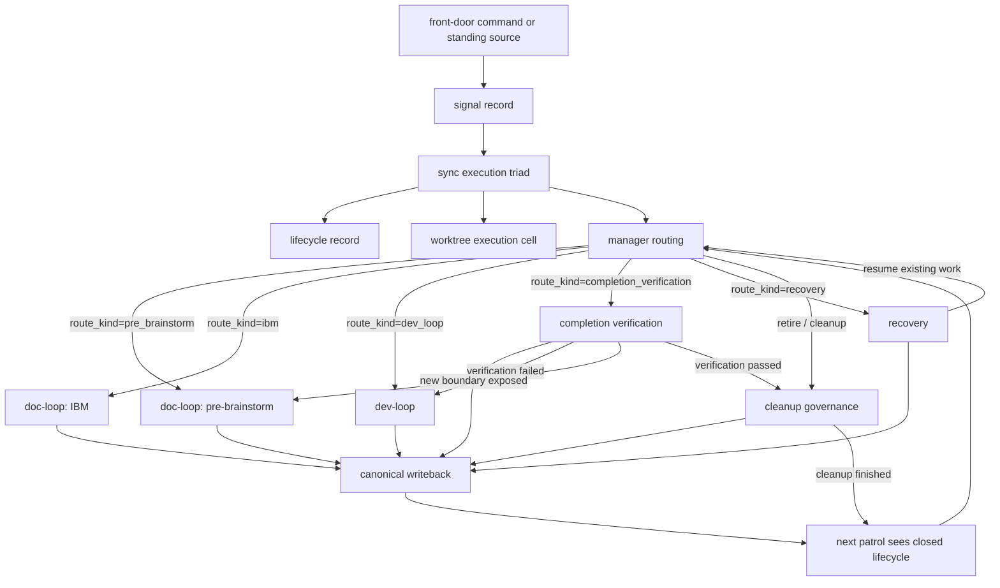
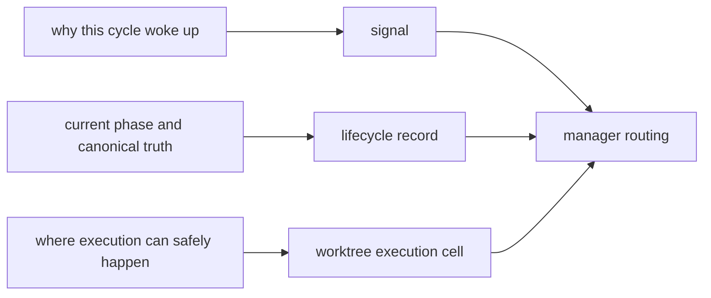
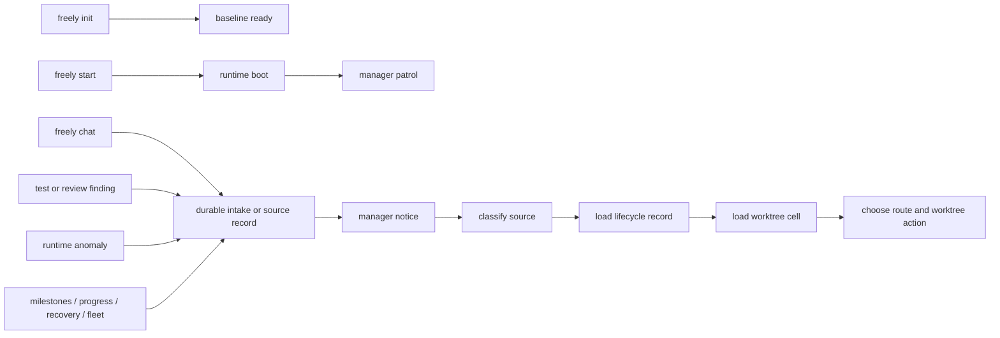
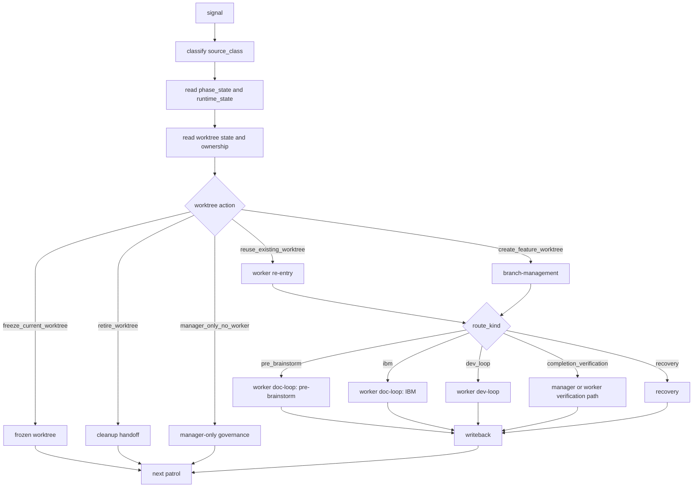
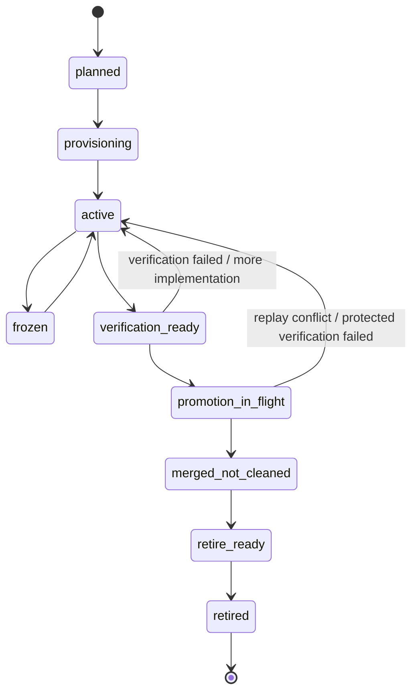
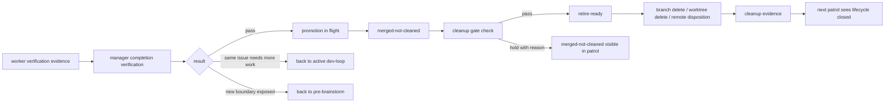
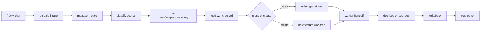
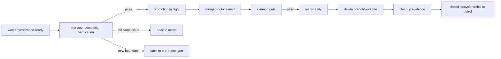

# Three-Loop Capability Lifecycle

Freely 三层 loop 的应用级事件地图真源。

边界：
- `CONSTITUTION.md`: 边界与硬约束
- `LAWS.md`: 状态词典、判定门、验收
- `SKILL.md`: 执行步骤

本文件只保留：
- 全应用流向图
- `signal -> lifecycle record -> worktree execution cell` 联动
- owner / artifact / route 决策表
- worktree 生命周期与 completion / cleanup 回路
- 省周期关键点

## 1. Whole-System Flow

说明：
- 任何一轮都先同步三元组，而不是只看 issue 或只看 worktree。
- `completion verification` 不是 cleanup；它是 promote 前后的验收回路。
- cleanup 完成后才算 lifecycle 真正闭环，不允许停在 `merged-not-cleaned`。

## 2. Execution Triad Map

三元组定义：
- `signal`: 这轮为什么被唤醒，例如 human interruption、patrol、test failure、review finding、runtime anomaly。
- `lifecycle record`: 当前 canonical 文档真相，例如 candidate、issue、progress、recovery、milestone。
- `worktree execution cell`: 当前真实执行容器，即 `branch + worktree + runtime/session + ownership`。

判定原则：
- 只看 `signal` 会丢掉当前做到哪一步。
- 只看 `lifecycle record` 会丢掉“该在哪棵树执行”。
- 只看 `worktree execution cell` 会把 dirty/clean 误判成业务完成度。

## 3. Front-Door Flow

## 4. Manager Routing Map

## 5. Worktree Lifecycle Map

约束：
- `completed` 属于 issue 生命周期，不等于 worktree 已退休。
- `merged-not-cleaned` 不是 terminal。
- `retire-ready` 只表示 cleanup gate 已过，还差正式删除与留痕。

## 6. Completion And Cleanup Flow

## 7. Loop Ownership Map

| Node | Primary owner | Main modules | Canonical artifacts |
| --- | --- | --- | --- |
| front-door intake | runtime | `freely init/start/chat`, runtime scripts | `.freely/intake/**`, runtime state |
| manager routing | manager-agent | `auto-loop-orchestrator`, `context-source-skill` | routing output, continuity |
| pre-brainstorm | worker | `doc-pre-brainstorm-execution` | `docs/pre-brainstorms/**` |
| IBM | worker | `doc-ibm-execution` | `docs/epics/**` |
| dev-loop | worker | `dev-loop-execution` | code, tests, reviews, progress |
| completion verification | manager -> worker | issue verification sections, review artifacts, protected acceptance evidence | issue, progress, milestone, cleanup pending truth |
| recovery | runtime + manager | runtime scripts, `recovery-subagent-governance` | `docs/recovery/**`, continuity |
| worktree action | manager + runtime | `branch-management`, worktree scripts | branch/worktree state |
| fleet supervision | manager | `multi-worktree-supervision`, `worktree-maintenance-governance` | fleet snapshot, disposition |
| cleanup governance | manager -> worker | `worktree-maintenance-governance`, `branch-management` | cleanup evidence |

## 8. Route Decision Table

| Condition | Route | Worktree default | Why |
| --- | --- | --- | --- |
| no stable issue boundary | `pre_brainstorm` | create | 先收敛边界，不提前写实现 |
| milestone-owned issue but IBM incomplete | `ibm` | reuse/create | 先补 issue 文档，不跳过文档层 |
| ready issue or explicit continuation | `dev_loop` | reuse | 默认回现有 active tree，减少新树与上下文切换 |
| `phase_state=in_verification` or milestone completed but cleanup open | `completion_verification` | reuse/manager-only | 不重复开发，直接处理 promote/cleanup |
| runtime/session unavailable or stale `in_*` | `recovery` | freeze/reuse | 先恢复 continuity，再决定是否继续 |
| cleanup gate already passed | cleanup governance | retire | 直接删树留痕，不让旧树继续占位 |

## 9. Worktree Action Table

| Action | Chosen by | Meaning | Next hop |
| --- | --- | --- | --- |
| `reuse_existing_worktree` | manager | current signal continues in an existing active tree | worker re-entry |
| `create_feature_worktree` | manager | current signal needs a new dedicated execution cell | `branch-management` |
| `freeze_current_worktree` | manager | tree remains visible but cannot continue now | next patrol / recovery |
| `retire_worktree` | manager | tree passed cleanup gate and should be removed | cleanup handoff |
| `manager_only_no_worker` | manager | this hop is governance-only and does not need worker execution | next patrol |

复用优先规则：
- 现有 issue continuation 默认复用当前 active worktree。
- 只有边界变化、树已退休、树不可安全继续、或需要独立 repair/research cell 时才新开树。

## 10. Worktree State Table

| Worktree state | Meaning | Usual owner |
| --- | --- | --- |
| `planned` | dedicated tree required but not created yet | manager |
| `provisioning` | branch/worktree creation or enter in progress | runtime + manager |
| `active` | tree is executing doc-loop or dev-loop | worker |
| `frozen` | tree is intentionally paused by dependency/runtime/hygiene reason | manager |
| `verification-ready` | worker finished current batch and is waiting for completion routing | manager + worker |
| `promotion-in-flight` | merge-up, merge-prep, replay, or protected acceptance is running | manager |
| `merged-not-cleaned` | target absorbed changes but branch/worktree disposition still open | manager |
| `retire-ready` | cleanup gate passed; delete/retain disposition remains to execute | manager |
| `retired` | local tree and branch removed; remote handled or retained-with-reason | manager |

## 11. Lifecycle Record Map

| Record | Main loop | Purpose |
| --- | --- | --- |
| `pre-brainstorm candidate` | doc-loop | discovery boundary |
| `issue` | doc-loop | issue boundary |
| `progress` | dev-loop | implementation continuity |
| `recovery` | auto-loop / recovery | recovery continuity |
| `milestones.md` | auto-loop + doc-loop | queue, index, orchestration |
| cleanup evidence | auto-loop | closure proof |

## 12. Event Matrix

| Event | Source | First owner | Loop entry | Lifecycle record update | Worktree action | Next hop |
| --- | --- | --- | --- | --- | --- | --- |
| `project_initialized` | `freely init` | runtime | auto-loop | baseline/bootstrap truth | none | wait/start |
| `manager_started` | `freely start` | runtime | auto-loop | runtime continuity updated | none | patrol |
| `human_chat_received` | `freely chat` | runtime -> manager | auto-loop | intake refs, issue refs, recovery refs | reuse/create/none | route |
| `standing_source_patrol` | milestones/progress/recovery/fleet | manager | auto-loop | continuity snapshot | reuse/create/freeze/retire/none | route |
| `new_discovery_confirmed` | manager routing | manager | doc-loop | pre-brainstorm + candidate | create | worker pre-brainstorm |
| `candidate_promoted_to_issue` | doc-loop | worker | doc-loop | issue + milestone | reuse/create | IBM |
| `issue_docs_ready` | IBM | worker | dev-loop | issue + milestone | reuse | dev-loop |
| `issue_continuation_confirmed` | manager routing | manager | doc-loop or dev-loop | issue/progress/recovery continuity | reuse | worker re-entry |
| `runtime_recovery_required` | runtime/session failure | runtime -> manager | recovery | recovery continuity | freeze/reuse/none | recovery |
| `checkpoint_or_hygiene_triggered` | worker or patrol | manager + worker | dev-loop | progress continuity | freeze/reuse | hygiene / continue |
| `verification_passed` | worker | manager | completion verification | issue/progress/milestone evidence | none | promote decision |
| `verification_failed_same_issue` | worker/protected verification | manager | dev-loop | blocker / next-step continuity | reuse | repair same tree |
| `verification_failed_new_boundary` | worker/protected verification | manager | doc-loop | candidate / issue reroute | create/reuse | pre-brainstorm |
| `promotion_started` | manager | manager | completion verification | verification continuity | none | merge-up / merge-prep / replay |
| `promotion_completed` | manager | manager | cleanup governance | cleanup pending truth | none | cleanup decision |
| `cleanup_gate_passed` | manager | manager | cleanup governance | cleanup readiness evidence | retire | branch-management cleanup |
| `cleanup_completed` | cleanup worker | manager | auto-loop governance | cleanup evidence | retired | patrol |
| `post_merge_new_finding` | review/test/patrol after promote | manager | discovery or dev-loop | new candidate / issue / blocker continuity | create/reuse | new repair route |

## 13. Standard Chains

### 13.1 Chat To Worker Execution

### 13.2 Verification To Retirement

## 14. Cycle-Saving Gates

| Gate | Default decision | Cycle saved |
| --- | --- | --- |
| issue continuation already has active tree | reuse existing worktree | 避免无意义新开 sibling tree |
| docs already sufficient for implementation | skip back to IBM and enter `dev_loop` | 避免重复文档收敛 |
| current batch only needs promote/cleanup | enter `completion_verification` instead of `dev_loop` | 避免重复开发和重复测试 |
| verification failed but boundary unchanged | return to same active tree | 避免把实现问题误升级成新 discovery |
| verification exposed a new boundary | reroute to `pre_brainstorm` | 避免把边界问题硬塞进当前 issue |
| cleanup gate passed | retire immediately | 避免停留在 `merged-not-cleaned` 占住树和注意力 |
| runtime broken but canonical truth intact | recovery before new work | 避免重做已经完成的 doc/dev 写回 |

## 15. Minimal Maintenance Rule

新增能力时只补对应真源：
- 新入口事件：补 `Whole-System Flow`、`Front-Door Flow` 或 `Event Matrix`
- 新 manager 判断：补 `Manager Routing Map` 或 `Route Decision Table`
- 新 worktree 状态：补 `Worktree Lifecycle Map` 和 `Worktree State Table`
- 新 promote / cleanup 分支：补 `Completion And Cleanup Flow`
- 新 loop 归宿：补 `Loop Ownership Map`
